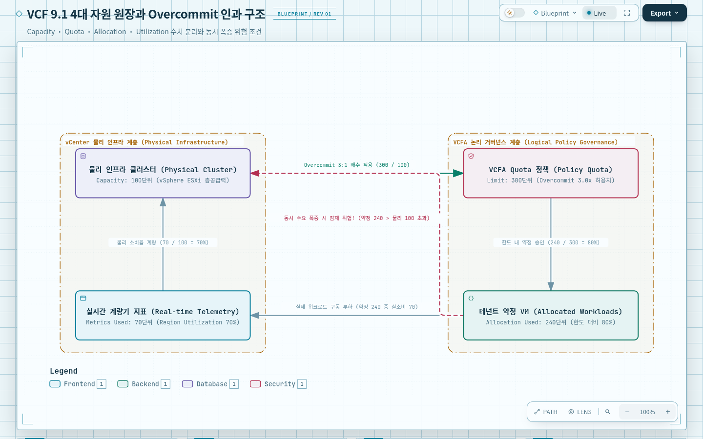
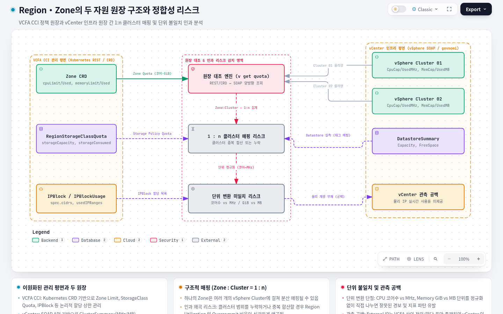
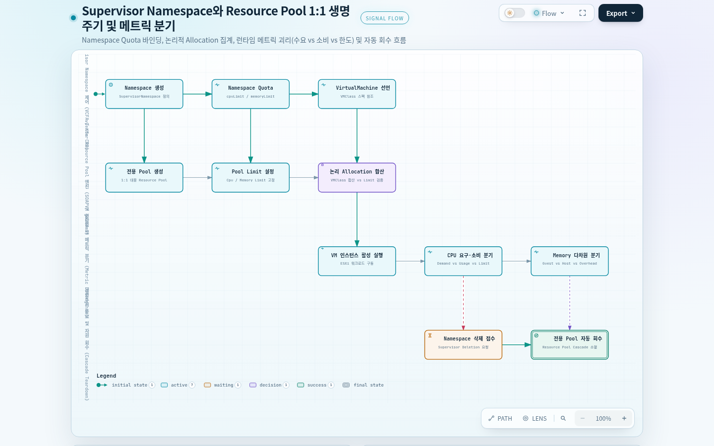
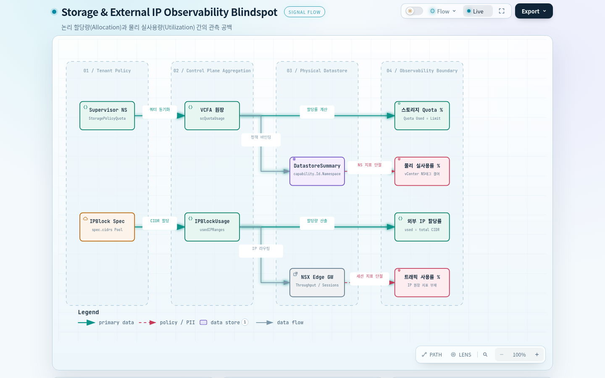
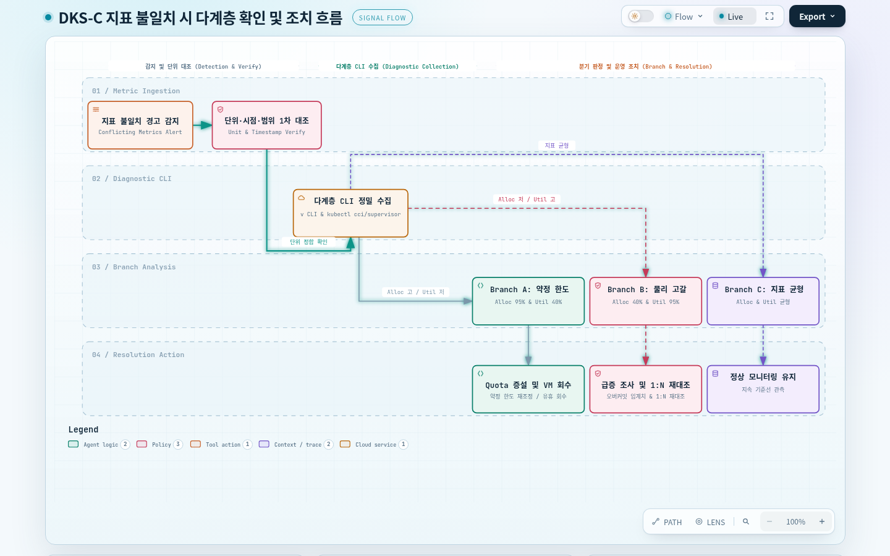

# 01. VCF 9.1 자원 할당과 실제 사용 — 어느 수치가 용량 부족을 말하는가?

## 문서의 목적

공장에 기계 20대를 설치할 권한이 있다는 말과 지금 기계 20대를 돌리고 있다는 말은 다릅니다. 전력 공급 한계보다 많은 기계의 설치를 허가해도 모든 기계가 동시에 최대 출력을 요구하지 않는다면 운영할 수 있습니다. 반대로 허가서에 빈칸이 남았더라도 실제 전력이 부족하면 새 기계를 작동시키지 못합니다.

이 문서는 VCF 9.1을 대상으로 정리된 DKS-C 인프라 기록에서 VCFA의 Quota·할당 정보와 vCenter의 물리 용량·사용 지표를 분리해 읽고, Region·Zone·Supervisor Namespace별로 무엇을 계산할 수 있는지 설명합니다. 이후 [[02. VCF Quota 동기화와 모니터링 판단]]에서 실제 임계치와 변경 동기화를 다룹니다. 문서 순서는 이해 순서이며 컨트롤러의 실행 순서를 의미하지 않습니다.

VCF(VMware Cloud Foundation)는 가상화 인프라와 이를 관리·제공하는 기능을 묶어 다루는 플랫폼입니다. 이 자료에서 **VCFA(VCF Automation)**는 사용자·Project·Supervisor Namespace의 자원 요청과 Quota 정보를 보여 주는 관리 인터페이스이고, **vCenter**는 ESXi 호스트·VM·Datastore·Resource Pool 같은 실제 가상화 자원을 관리하고 통계를 제공하는 시스템입니다. ESXi는 물리 서버 위에서 VM(가상 컴퓨터)을 실행하는 가상화 계층입니다. 두 시스템을 보는 이유는 같은 CPU·메모리라도 '이용을 허용한 양'과 '장비가 실제 감당하고 쓰는 양'이 서로 다른 계층에 기록되기 때문입니다. 이는 두 관리 화면 중 하나만이 항상 진실이라는 뜻이 아니라, 질문에 맞는 원장을 선택하고 서로 대응시켜야 한다는 뜻입니다. [S1: ‘APIs’, ‘vCenter Data Object’, ‘VCFA CRD’]

> 근거 범위: [[VCF 9.1 인프라 Utilization 모니터링]]의 2026-09-01 기준 기록을 재구성했습니다. 계산식·필드명·임계치의 일부는 원문에서 복원된 표이므로 현행 VCF 9.1 배포에서 검증한 값으로 승격하지 않습니다. 특히 Namespace별 CPU·Memory 필드 열 배치, 단위 변환, Namespace Utilization 분모는 원본 대조가 필요합니다. [S1]

## 전체 인과 지도

공장 단지 운영자는 전력 공급 설비의 최대 용량을 알아야 하고, 각 생산팀에 얼마까지 설비를 설치해도 된다고 약속했는지도 알아야 합니다. 허용량과 실제 가동량은 다른 원장이므로 하나의 비율로 합치면 증설 판단을 잘못하게 됩니다. VCF에서는 VCFA의 Quota·Allocation과 vCenter의 Capacity·실측 지표를 함께 보아야 합니다.

생산팀이 여러 공장에 나뉘어 있을 때 공장 전체의 전력 부족과 한 팀의 배정량 부족은 서로 다른 사건입니다. DKS-C 자료에서 Zone은 하나 이상의 vSphere Cluster와 연결되는 자원 범위이며, Supervisor Namespace는 VM을 만들도록 할당된 별도 관리 범위입니다. 어느 범위에 속한 수치인지 먼저 고정해야 동일한 비율도 의미가 분명해집니다.

또한 공장 전력계는 누가 전력을 얼마나 쓰는지 비교적 직접 보여 주지만, 공동 창고의 물품 사용량은 물품 종류별 총량만 알 수 있을 수 있습니다. 가상화 인프라에서 **Datastore**는 VM 디스크 데이터를 저장하는 공간이고, **Storage Policy**는 그 디스크를 어떤 저장 특성·배치 규칙으로 제공할지 정의하는 정책입니다. 정책별 할당량과 Datastore 물리 점유량의 집계 범위가 반드시 같지는 않습니다. 원문에서도 Storage Policy별 물리 사용량은 조회되지만 Namespace별 Storage 물리 사용량 산출 경로는 확인되지 않았습니다. 이때 Namespace의 Storage 할당률을 실제 Storage 사용률이라고 바꾸어 부를 수 없습니다.

### Capacity·Quota·Allocation·Utilization

공장 전체가 공급할 수 있는 전력 100단위, 각 팀에 허용한 설비 총량 300단위, 실제 설치된 설비의 계약상 최대 요구량 240단위, 지금 계량기에 잡힌 소비량 70단위를 구별해 보겠습니다. 허용 총량은 공급량의 3배지만 현재 소비량은 공급 한계의 70%입니다. 허용량을 초과하지 않았다는 사실과 실제 용량에 여유가 있다는 사실은 서로 다른 결론입니다.

VCF의 이 문서에서는 **Capacity**를 물리적으로 사용 가능한 자원, **Quota/Limit**를 허용 상한, **Allocation/Used**를 VM 등에 이미 약정·할당한 양, **Utilization/Metrics**를 관측된 사용으로 구분합니다. CPU·Memory를 공급량보다 더 많이 약정하는 것을 Overcommit, Storage를 더 많이 논리적으로 공급하는 것을 주로 Overprovisioning이라고 부릅니다. Overcommit이 있다는 사실 자체는 곧 장애가 아니라, 동시 수요가 Capacity를 압박할 때 위험해진다는 운영 조건입니다. [S1: ‘용어’, ‘비율(%) 계산’]




| 판단 질문 | 원문 기준 산식 | 읽을 때 반드시 고정할 것 |
|---|---|---|
| 총 허용량은 물리량의 몇 배인가? | Overcommit 배수 = 총 Quota Limit / 물리 Capacity | 동일 자원, 동일 범위, 단위 통일 |
| 이미 약속한 양이 한도의 몇 %인가? | Allocation % = Allocation Used / Quota Limit × 100 | 약속한 VM 사양과 이미 사용한 물리량을 혼동하지 않음 |
| Region 물리 용량이 얼마나 바쁜가? | Region Utilization % = Metrics Used / Capacity × 100 | 같은 시각·같은 Zone/Storage 범위의 관측 |
| Namespace 정책상 사용 정도는? | 원문 제안식: Metrics Used / (Namespace Limit × Overcommit 배수) × 100 | 정책 지표이지 범용 물리 사용률 공식이 아님; 분모 정의 재검증 필요 |

예를 들어 CPU의 실제 Capacity와 이미 할당한 값이 모두 같은 단위라고 가정하면, Capacity 100, Region Limit 300, Allocation Used 240, Metrics Used 70일 때 Overcommit 3:1, Allocation 80%, Region Utilization 70%입니다. 이 수치는 관계를 설명하는 **가상 예시**이며 VCF 환경의 실측이 아닙니다. CPU 코어 수와 MHz, Memory GiB와 MB는 변환 없이 직접 나누지 않습니다. 'Limit'이 실효 한도인지 정책 상한인지도 조회 객체별로 구분해야 합니다.

공급 허가를 팀마다 나누어도 전체 공급 용량은 저절로 늘지 않습니다. Namespace의 사용량을 *공장 전체 Capacity*로 나누면 그 팀이 전체에 주는 부담을 볼 수 있고, *팀 자체의 정책 기준*으로 나누면 팀이 자기 허용 범위에 얼마나 가까운지를 볼 수 있습니다. 원문은 vCenter UI Namespace Utilization을 'Namespace Metrics / 전체 Capacity'로, 별도 Quota 관리 관점의 Namespace 지표를 'Metrics / (Limit × Overcommit)'으로 기술합니다. 두 지표는 분모와 질문이 다릅니다. 특히 후자는 Overcommit 배수가 Region에서 정의됐는지 Namespace에 재적용해야 하는지 근거가 불명확하므로 그대로 경보 공식으로 승인하기 전에 단위와 목적을 확인해야 합니다. [S1: ‘비율(%) 계산’, ‘CPU/Memory 관련 지표’]

### Region·Zone의 두 자원 원장

공장 구역 관리자는 팀별 설치 허가서를 합쳐 얼마를 약속했는지 파악합니다. 동시에 변전 설비가 실제로 감당할 수 있는 전력과 현재 계량기의 값을 읽습니다. 한 장부에서 두 숫자가 모두 나오지 않으므로 대응 관계를 맞춰야 합니다.

VCFA는 Kubernetes API 형식의 사용자 정의 자원(Custom Resource)을 통해 정책상의 Limit와 Used를 주로 제공합니다. CRD(CustomResourceDefinition)는 **자원 종류의 스키마**이고, `Zone`·`SupervisorNamespace` 등은 그 스키마를 따라 실제 값을 담는 **자원 객체**입니다. `kubectl`은 해당 API Context를 선택해 이 객체들을 읽는 도구이지 ESXi의 순간 CPU 사용량을 직접 측정하는 장치가 아닙니다. 반대로 vCenter는 vSphere Cluster, Datastore, Resource Pool의 Capacity와 Metrics를 제공합니다.

자원 범위도 먼저 구분해야 합니다. **Region**은 여러 Zone·Storage 정책 등을 묶어 운영 지표를 집계하는 상위 범위이고, **Zone**은 VM을 수용할 인프라 구역입니다. **vSphere Cluster**는 여러 ESXi 호스트를 묶어 자원을 관리하는 단위입니다. 원문은 Zone 하나에 vSphere Cluster가 여러 개 연결될 수 있다고 기록합니다(`Zone : vSphere Cluster = 1 : n`). 따라서 Region에서 Zone별 합계를 만들거나 Zone에 매핑된 Cluster를 합산할 때 대응 범위가 맞는지 먼저 확인해야 합니다. 같은 Cluster를 두 번 합산하거나 일부를 빼면 Utilization과 Overcommit 모두 잘못됩니다. [S1: ‘vCenter Data Object’, ‘VCFA CRD’]




| 대상 | VCFA에서 읽는 할당/한도 | vCenter에서 읽는 물리량/사용 | 산출할 수 있는 것 |
|---|---|---|---|
| Region의 CPU | `Zone.spec.cpuLimit`, `Zone.spec.cpuUsed` (원문 필드 표기) | `ClusterResourceUsageSummary.CpuCapacityMHz`, `CpuUsedMHz` | Allocation, 조건부 Region Utilization·Overcommit |
| Region의 Memory | `Zone.spec.memoryLimit`, `Zone.spec.memoryUsed` | `ClusterResourceUsageSummary.MemCapacityMB`, `MemUsedMB` | Allocation, 조건부 Region Utilization·Overcommit |
| Region의 Storage | `RegionStorageClassQuota.spec.storageClassName`, `storageCapacity`, `status.storageConsumed` | `DatastoreSummary.Capacity`, `Capacity - FreeSpace` | Policy별 할당과 매핑 가능한 Storage 사용 |
| External IP | `IPBlock.spec.cidrs`, `IPBlockUsage.usedIPRanges` | 이 자료에서 별도 물리 사용률 제공 안 함 | 정의된 주소 풀과 할당된 주소 수 |

여기서 CPU `Zone.spec.cpuLimit`와 vCenter MHz는 표현 단위가 서로 다를 수 있습니다. 원문 표에서 두 필드를 바로 나누어 표현한 것은 **조회 대상 매핑의 초안**으로 읽고, 구현 시 MHz↔코어 또는 실제 제품 API가 반환하는 단위를 검증해야 합니다. Memory도 동일합니다. Storage의 `DatastoreSummary` 총량은 항상 개별 Storage Policy에 1:1 대응한다는 뜻이 아닙니다. 원문은 Storage Policy 구별에 태그 조건 `capability.Id.Namespace == "http://www.vmware.com/storage/tag"`를 사용했다고 기록하므로, Datastore와 Policy의 포함 관계를 대조해야 중복 계상을 피할 수 있습니다.

허가서의 총량과 장비 계량의 총량은 여러 시스템의 데이터를 결합한 결과입니다. VCF의 조회 경로도 VCFA **CCI(Cloud Consumption Interface, 클라우드 자원 소비·관리 API 계층)**·Supervisor Context의 REST/Kubernetes API와 vCenter의 SOAP 기반 vSphere Web Services API(govmomi) 및 vSphere Automation REST API로 갈립니다. 이 둘을 조합한 예제 도구가 원문의 `v get quota`입니다. 외부 API가 무엇을 돌려주는지 읽는 일과 현장에서 같은 값이 조회되는 일은 다른 검증입니다. [S1: ‘APIs’, ‘구현(개발) 예제’]

### Supervisor Namespace·Resource Pool

생산팀에 배정된 별도 작업 구역을 만들면 팀용 관리장부도 함께 있어야 합니다. 장부에는 그 팀에 허가한 장비 상한을 적지만, 장부 수치를 읽는다고 실물 기계의 순간 소비량을 알 수 있는 것은 아닙니다.

**Supervisor Namespace**는 이용자가 VM을 만들 수 있도록 CPU·메모리·Storage 상한 등을 부여하는 Supervisor 측 관리 범위입니다. 일반 Kubernetes Namespace가 Pod 등 리소스의 이름·소속을 나누는 단위인 것과 달리, 여기서는 VM 프로비저닝을 위한 인프라 Quota의 소속을 결정한다는 점이 중요합니다. 한 Namespace의 VM마다 **VMClass**(한 VM의 vCPU·메모리 사양)를 선택하므로, VMClass 한 개의 값은 Namespace 전체의 Quota가 아닙니다. 여러 VM의 사양을 합산해야 이미 약속한 Allocation의 크기를 이해할 수 있습니다.

원문에서 vCenter는 Supervisor Namespace마다 대응하는 **전용 Resource Pool**을 생성하고, Namespace CPU·Memory Quota를 해당 Pool 설정에 연결합니다. Namespace를 삭제하면 대응 Pool도 함께 삭제되는 것으로 기록됩니다. Resource Pool은 여러 VM에 대한 CPU·메모리 상한과 사용 통계를 함께 관리하도록 만든 vCenter의 **논리적 자원 묶음**이지 물리 ESXi 호스트나 전용 Cluster가 아닙니다. 그러므로 이 Pool의 `Config.*Allocation.Limit`는 설정된 관리 상한을, `QuickStats`·`Runtime`은 실제 수요·사용 또는 그때의 가용 상태를 나타냅니다. Namespace Quota가 Pool 설정으로 반영된다는 관찰만으로 VM을 새로 배치할 실제 호스트 여유가 항상 확보됐다고 결론 내릴 수는 없습니다. [S1: ‘Supervisor Namespace 생성/삭제 시 Resource Pool’, ‘VCFA CRD’]




| 질문 | 원문에 나타난 조회 단서 | 값이 뜻하는 범위 |
|---|---|---|
| Namespace의 CPU/Memory 허용치 | `SupervisorNamespace.status.zones[*].cpuLimit`, `memoryLimit` | Namespace·Zone 범위별 정책 Limit |
| VM별 약속한 CPU/Memory | `VirtualMachine`의 VMClass 참조, `VirtualMachineClass.spec.hardware.cpus`, `.memory` | VM 사양을 합산한 논리적 Allocation |
| CPU 실제 수요의 후보 | `ResourcePoolSummary.QuickStats.OverallCpuDemand` | Resource Pool의 CPU demand 통계, 반드시 실소비와 동일하다고 단정 불가 |
| CPU 소비·한도·가능 상한 | `.QuickStats.OverallCpuUsage`, `.Config.CpuAllocation.Limit`, `.Runtime.Cpu.MaxUsage` | 서로 다른 CPU 사용·설정·런타임 가능량 |
| Memory 호스트 점유·오버헤드 | `.QuickStats.HostMemoryUsage`, `.QuickStats.OverheadMemory` | 물리 호스트 관점 점유와 가상화 비용 |
| Memory 게스트 관점 | `.QuickStats.GuestMemoryUsage` | 게스트 관점 보고값; 곧 '활성 메모리'라는 보장 없음 |
| Memory 한도·가능 상한 | `.Config.MemoryAllocation.Limit`, `.Runtime.Memory.MaxUsage` | 설정상 Limit와 그 시점의 가용 상한 |
| Namespace Storage 할당 | `StoragePolicyQuota.status.total[*].scQuotaUsage.limit/used` | Storage Policy별 논리적 Quota/Used |

CPU는 '지금 필요하다고 요구하는 양(Demand)'과 '실제 제공받아 사용하는 양(Usage)'이 다를 수 있습니다. Memory 역시 Guest/Host/Overhead/Active는 같은 지표가 아닙니다. 원문에는 CPU `Active ≈ OverallCpuDemand`, Memory `Consumed + Overhead`를 Namespace 사용량 후보로 두고, `Utilization = 측정 사용량 / (Limit × Overcommit)`으로 적은 예가 있습니다. 그러나 원문이 'Active Memory'를 `GuestMemoryUsage` 합계로 설명하는 대목, CPU·Memory 표의 열 배열, `Limit - MaxUsage`의 사용 위치는 재검증 대상입니다. 이런 불확실성을 숨기고 인프라 장애를 판정하면 잘못된 경고가 나올 수 있습니다. [S1: ‘Supervisor Namespace 계산식’, ‘CPU 관련 지표’, ‘Memory 관련 지표’]

### Storage·External IP에서 생기는 관측 공백

공동 창고는 물품 종류별 재고 변화를 보여 주지만 각 팀이 실제로 점유한 부피는 따로 계량하지 않을 수 있습니다. 팀별 물품 반출 약속과 창고 전체의 남은 공간만으로 팀별 실제 공간 점유율을 자동 복원할 수는 없습니다.

원문은 VCFA의 `SupervisorNamespace`와 `StoragePolicyQuota`에서 **Namespace/Policy별 Storage Quota Limit·Used**를 읽을 수 있지만, vCenter에서는 **Storage Policy별 물리 사용량**까지만 확인했다고 명시합니다. 따라서 Namespace Storage **Allocation %**는 계산할 수 있어도, Namespace별 **물리 Utilization %**는 이 자료만으로 산출할 수 없습니다. Region의 Storage Utilization을 Namespace의 실제 Storage Utilization으로 표기해서는 안 됩니다. [S1: ‘비율(%) 계산’, ‘주의사항’]

공장 단지가 배송 차량에 쓸 출입 번호를 여러 개 예약할 수 있다고 해서 모든 번호가 지금 출입 중이라는 뜻은 아닙니다. External IP는 VM·서비스가 외부 통신에 사용할 수 있는 네트워크 주소를 뜻하며, **CIDR**은 IP 주소 여러 개를 범위로 표현하는 방식입니다. `IPBlock`은 허용되는 주소 범위를, `IPBlockUsage`는 실제로 할당된 주소 정보를 구별해 기록합니다. 원문 Region 매핑 표에는 `IPBlock.spec.cidrs + 2`라는 축약이 있지만, CIDR별 사용 가능 주소 수와 예약 주소 처리 규칙을 알기 전에는 그대로 수식으로 구현하지 않습니다. `IPBlockUsage.usedIPRanges`로 할당 현황은 살펴볼 수 있어도 전송량·통신 성공의 Utilization과는 다른 지표입니다.



### 수치가 서로 다를 때의 확인 경로

관리실 화면에 빨간 경고가 보이면 바로 공장 증설을 결정하기보다, 전력계 단위·관리 구역·측정 시간을 확인해야 합니다. 서로 다른 화면에서 같은 숫자가 나왔다는 사실도 동일 대상·동일 시각이라는 증거는 아닙니다.

DKS-C 기록의 예제 도구와 조회 명령은 다음과 같습니다. `v`는 원문에 제시된 구현·개발 도구의 예이며 모든 환경에서 설치되어 있다는 뜻은 아닙니다. 조회만 실행하는 코드와 정책을 바꾸는 코드를 구분합니다. [S1: ‘구현(개발) 예제’, ‘조회·수정 명령’]

```bash
v get quota
v get ns
v get ns <supervisor-namespace-name>
kubectl get zone --context=cci
kubectl get svns <svns-name> -n <project-name> --context=cci
kubectl get regionstorageclassquota --context=cci
kubectl get storagepolicyquota -n <svns-name> --context=supervisor
```

각 수치마다 '대상 Region/Zone/Namespace → 리소스 종류 → Limit/Used/Metrics/Capacity → 단위 → 수집 시점'을 남기면 Allocation과 Utilization의 충돌을 해석할 수 있습니다. 예를 들어 Allocation 95%와 Utilization 40%는 모순이 아니라 '추가 약정 여유는 작지만 현재 물리 부하는 낮다'는 서로 다른 경고일 수 있습니다. 그 반대로 Allocation 40%, Utilization 95%라면 실제 사용 급증, 측정 범위 차이, 과거 약정 누락 등 경쟁 설명을 검토해야 하며 한 원인으로 단정하지 않습니다.



## 질문별 자료 안내

| 표기 | 이 문서에서 확인하는 질문 | Obsidian 원자료와 위치 |
|---|---|---|
| S1 | 정의·기본 산식·API·Region/Namespace 소스 필드와 미확인 값 | [[VCF 9.1 인프라 Utilization 모니터링]] — '용어', '비율(%) 계산', 'APIs', 'vCenter Data Object', 'VCFA CRD', '계산식 — Region', '계산식 — Supervisor Namespace', 'CPU 관련 지표', 'Memory 관련 지표' |
| S2 | Quota·Namespace 인프라 경계의 추가 맥락 | [[VCFA CCI CRDs 및 Quota 가이드]], [[VCFA 인프라 아키텍처]] — 관련 참고 노트; 이 문서 작성 시 내용 신규 실측하지 않음 |

다음 질문은 “이 수치를 보고 무엇을 변경할 것인가?”입니다. 정책 한도와 실제 물리 부하를 구분한 뒤 [[02. VCF Quota 동기화와 모니터링 판단]]에서 경고 임계치와 변경 전파 범위를 이어 봅니다.