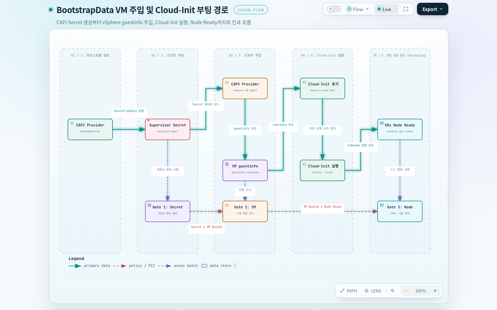
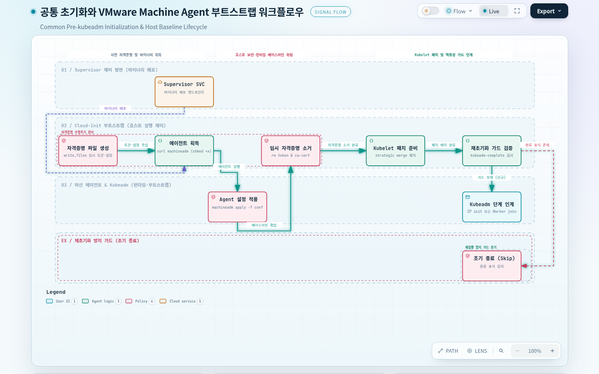
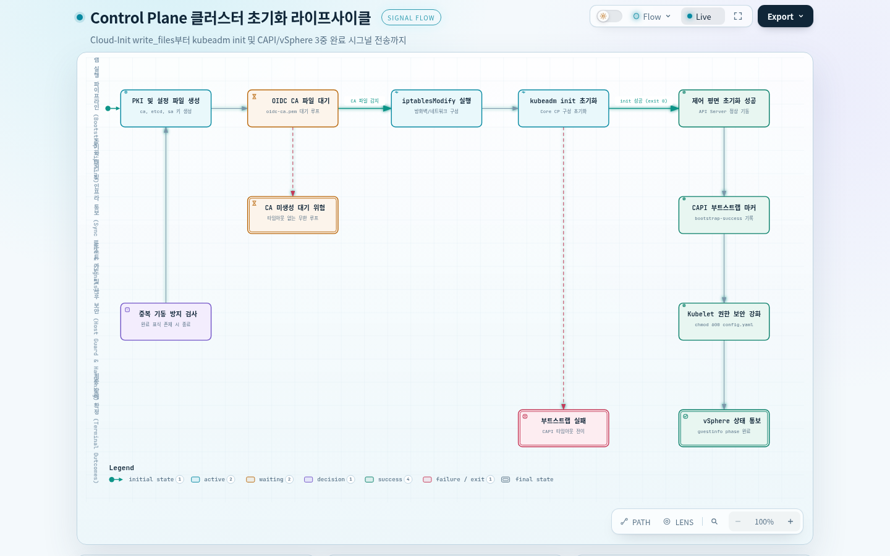
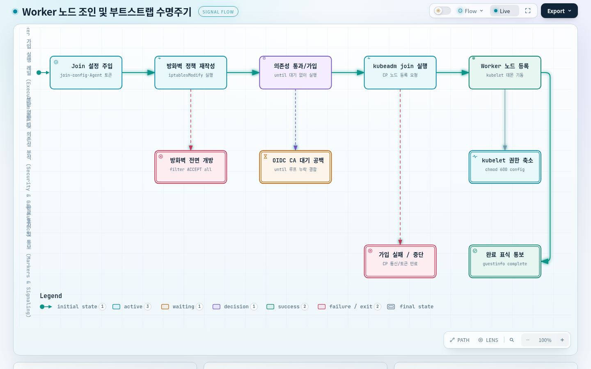
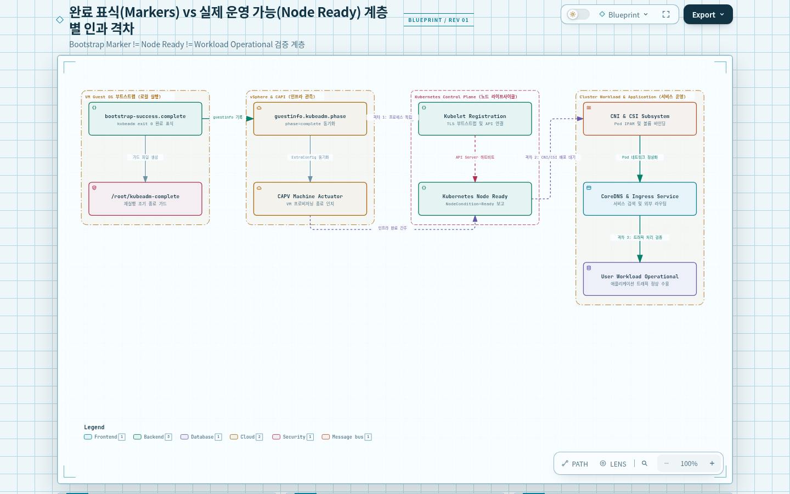

# 04. CAPI Cloud-Init과 Node 부트스트랩 — VM은 언제 Kubernetes Node가 되는가?

## 문서의 목적

공장에 새 생산 장비를 들여놓아 전원을 켰다고 바로 라인이 돌아가지는 않습니다. 장비의 통신 주소를 지정하고, 제어 프로그램을 설치하고, 중앙 제어실과 통신하는 시험을 거쳐야 작업에 참여할 수 있습니다. 표준 설계서가 완성됐다는 사실과 실제 기계가 가동된다는 사실은 구별됩니다.

DKS-C에서는 CAPI의 Machine/BootstrapData가 VM에 필요한 초기화 구성을 제공하고, VM 부팅 중 Cloud-Init이 파일 생성과 명령 실행을 수행합니다. **CAPI(Cluster API)**는 Kubernetes Cluster와 그 노드의 생성·교체를 API 리소스와 조정 Controller로 관리하는 방식입니다. 여기서 **Machine**은 '노드 한 대를 만들어 유지한다'는 관리 리소스이고, **VM(Virtual Machine)**은 vSphere가 실제 실행하는 가상 컴퓨터이며, **Node**는 VM 속 kubelet이 Kubernetes API에 등록한 작업 단위입니다. kubelet은 노드에서 컨테이너 실행 상태를 보고하고 관리하는 에이전트이므로, Machine이 존재하거나 VM 전원이 켜졌다는 것만으로 Node 객체나 Ready 상태가 성립하지 않습니다.

**Cloud-Init**은 VM 운영체제가 초기 부팅 설정을 받아 파일·계정·명령을 구성하도록 돕는 초기화 체계이고, **kubeadm**은 Kubernetes Control Plane을 초기화하거나 기존 클러스터에 노드를 합류시키는 도구입니다. 이 문서는 Control Plane의 `kubeadm init`과 Worker의 `kubeadm join`을 기준으로, 구성의 전달·VM 내부의 초기화·완료 표식·실제 Node 준비 상태를 구분합니다. 정책 정의가 어디서 출발하는지는 [[03. DKS-C ClusterClass 정책 적용]]을 참조합니다.

> 자료 범위: [[Cluster & Custom ClusterClass Cloud-Init 프로세스]]의 Control Plane/Worker `write_files`·`runcmd` 및 2026-08-11 로그 예제를 재구성했습니다. 해당 파일의 예제는 특정 환경의 기록이며 지금 운영 중인 모든 VM의 실행 결과를 신규 조회한 것이 아닙니다. 일부 원문 로그는 도중에 잘렸으며 Cloud-Init 전체 로그의 성공 여부를 이 자료만으로 확정하지 않습니다. [S1]

## 전체 인과 지도

공장 관리자가 설비 한 대를 추가하기로 해도 기계 설치 업체에는 모델별 설치 지침서가 필요합니다. CAPI의 `Cluster`는 원하는 클러스터를, `Machine`은 개별 노드 한 대의 생성·교체 대상을 표현합니다. Bootstrap Provider는 그 Machine이 Kubernetes에 참여하는 데 필요한 역할별 초기화 자료를 준비하고, 인프라 제공자가 그 자료를 VM 부팅 경로에 연결합니다.

설치 지침서가 기계로 전달되면 운영 체제는 네트워크를 준비하고, 필요한 구성 파일을 만들고, 설치 명령을 실행해야 합니다. Cloud-Init의 여러 부팅 단계 중 `write_files`가 파일을 준비하고 `runcmd`가 명령을 실행하도록 기록된 이유입니다. 이 안에 VMware Machine Agent 준비와 kubeadm 실행이 있고, DKS-C의 Custom ClusterClass Patch가 추가한 OIDC CA·iptables·파일 권한 조정도 포함됩니다.

제어실을 처음 설정하는 명령과 이미 운영 중인 제어실에 장비를 등록하는 명령은 다릅니다. Control Plane은 클러스터 초기화에 필요한 인증서·제어 평면 설정과 `kubeadm init`을 사용하고, Worker는 가입 설정과 `kubeadm join`을 사용합니다. 두 역할의 Cloud-Init을 같은 스크립트로 단순화하면 존재하지 않는 파일이나 잘못된 완료 조건을 전제하게 됩니다.

설치 지침서가 '완료'를 기록해도 생산 라인에 실제로 합류해 작업이 가능한지는 별도로 확인해야 합니다. kubeadm 명령의 성공 표식, VM guestinfo 단계, Kubernetes Node 등록·Ready는 서로 다른 관측 지점입니다. 특히 Custom Patch에 의존하는 파일이 만들어졌는지와 그 파일을 사용하는 프로세스가 정상 동작하는지도 구분해야 합니다.

### BootstrapData가 VM에 들어가는 경로

각 장비의 초기 설정을 본사 설계도에서 직접 실행하는 대신 장비별 설치 봉투에 넣어 보내면 설치팀이 그 내용을 읽고 적용할 수 있습니다. 봉투에는 설치가 끝났다는 기록이 아니라 앞으로 실행할 지침이 담깁니다.

CAPI에서 **Bootstrap Provider**는 Machine 역할에 맞는 노드 초기화 자료를 준비하는 구성요소입니다. 그 결과인 **BootstrapData**는 VM에서 실행할 파일 생성 지시·명령·가입 설정의 내용이지, 준비 완료를 알리는 상태값이 아닙니다. **Infrastructure Provider**는 Machine이 필요로 하는 실제 인프라 객체와 VM 준비를 연결하는 역할이고, VM은 자신에게 전달된 초기화 데이터를 부팅 과정에서 적용해야 합니다. Control Plane에 필요한 초기 제어 평면 설정과 Worker의 가입 설정은 서로 달라서 BootstrapData도 역할별로 나뉩니다. 이 관계에서 'BootstrapData를 준비했다 → VM에 전달됐다 → VM이 실행했다 → Node가 등록됐다'는 **서로 구분해서 확인할 단계**이지 Secret 생성 하나로 모두 입증되는 동기식 호출 순서가 아닙니다.

원문은 Supervisor Namespace의 VM별 Secret에서 `cloud-config`를 조회할 수 있다고 기록합니다. **Supervisor Namespace**는 vSphere 측에서 VM 생성과 자원 한도를 관리하는 범위이고, Kubernetes **Secret**은 초기화 자료 등 민감한 데이터를 API 객체로 보관하는 방식입니다. Secret은 접근권한과 보안 처리가 필요한 객체이므로, Base64는 암호화가 아니라 인코딩이라는 점을 기억해야 합니다. 원문 예시는 다음과 같지만 **조회 결과에는 토큰·키·인증서가 포함될 수 있어 회의 자료나 공유 로그에 원문을 붙여 넣지 않습니다.** [S1: ‘CAPI 부트스트랩 구성’]




```bash
# 원문의 VM별 Secret 조회 형식(민감 데이터 출력 가능, 승인된 환경에서만 사용)
kubectl get secret <machine-name> -o jsonpath='{.data.value}' | base64 -d
```

봉투 안에는 실행 명령뿐 아니라 작업 순서와 설정 파일 내용이 함께 있어야 합니다. 원문 `cloud-config`는 `write_files`(파일 경로·권한·내용에 따라 설정 파일 생성), `runcmd`(부팅 과정에서 실행할 명령 목록), `ntp`(시간 동기화 설정), `users`(사용자 계정) 등을 포함합니다. 예를 들어 `write_files`에 kubelet 구성이 없으면 그 파일을 참조하는 후속 명령은 필요한 입력을 찾지 못할 수 있습니다. 반대로 파일이 있어도 `runcmd`가 성공했다는 뜻은 아닙니다. CAPI Machine의 상태와 VM의 실제 파일 상태는 별도 대상이므로, Secret 생성만으로 Kubernetes Node 등록을 판단하지 않습니다.

장비에 전원이 들어온 뒤에는 초기 데이터의 위치를 알아내고, 로컬·네트워크 설정을 처리하고, 나머지 구성 모듈과 마지막 명령을 적용할 기회가 필요합니다. 원문은 Cloud-Init 단계 흐름을 **Detect → Local → Network → Config → Final**로 요약합니다. Detect는 초기 설정 데이터의 출처를 판단하는 과정, Local과 Network는 초기 네트워크의 준비 시점이 다른 작업, Config와 Final은 이후 구성과 마지막 초기화 모듈을 실행하는 구간으로 이해할 수 있습니다. 이것은 단계가 수행하는 **역할을 설명한 것**이며, 특정 원문 로그의 어떤 한 줄이 어느 단계에서 성공했는지는 별도 로그로 확인해야 합니다. 특히 `runcmd`는 명령 목록의 기술이고, 그 목록의 실행 여부는 최종 단계의 실제 결과를 확인해야 합니다. 별도 CAPI Controller가 이 다섯 단계를 직렬로 실행한다는 의미도 아닙니다. [S1: ‘Cloud-Init 기본’]

### 공통 초기화와 Machine Agent

서로 다른 생산 기계라도 장비 관리 프로그램과 기본 점검 도구가 필요합니다. 이 준비가 끝나야 역할별 제어 프로그램을 설치할 수 있습니다. 다만 관리 프로그램을 받는 주소가 특정 공장에 고정돼 있다면 다른 공장에서는 그대로 사용할 수 없습니다.

원문 Control Plane의 `runcmd` 공통부와 Worker가 참조하는 공통부는 다음 관계로 기록됩니다. 각 항목은 파일·명령이 무엇을 바꾸는지를 기준으로 묶었습니다. [S1: ‘Control Plane cloud-config — runcmd’, ‘Workers cloud-config — runcmd’]




| 초기화 요소 | 원문 파일·명령 위치 | 수행하려는 역할 |
|---|---|---|
| 기본 파일·사용자 | `cloud-init single --name write-files --frequency always`, `users-groups` | 초기 설정 파일·계정 관련 처리 |
| 초기화 데이터 정리 | `vmware-rpctool 'info-set guestinfo.userdata ---'` | VM guestinfo의 user-data 상태 정리 |
| VMware Machine Agent | `/run/machine-agent/{ca-cert,conf,token}` | Agent 다운로드·인증·설정에 필요한 임시 데이터 |
| Agent 프로그램 확보 | `curl`로 `/usr/local/bin/machineadm` 다운로드 후 실행 권한 부여 | Supervisor 서비스에서 설치용 프로그램 획득 |
| Agent 설정 적용 | `/usr/local/bin/machineadm apply -f /run/machine-agent/conf --log-level DEBUG` | VM의 Registry·방화벽·CA·예약 리소스 등 기초 설정 반영 |
| Kubelet 구성 패치 | `/run/kubelet-configuration.yaml` → `/run/kubeadm/patches/kubeletconfiguration0+strategic.yaml` | kubeadm이 사용할 KubeletConfiguration 준비 |
| OS 기본 설정 | `/etc/hostname`, `/etc/cloud/cloud.cfg`, `/etc/sysctl.d/kubelet.conf` | 호스트명·보존 설정·커널 관련 값 |
| 재초기화 방지 단서 | `/root/kubeadm-complete` 존재 시 조기 종료 | kubeadm 명령의 중복 실행을 제한하려는 가드 |

**VMware Machine Agent**는 노드 VM의 운영체제 환경에 기본 설정을 적용하는 구성요소입니다. 원문의 `/run/machine-agent/conf`에는 `spec.containerRuntimeSpec`(컨테이너 이미지를 가져오는 Registry 신뢰·런타임 설정), `spec.firewallSpec`(네트워크 인바운드 규칙), `spec.systemCAs`(운영체제가 신뢰할 CA), `spec.systemReserved`(시스템 자원 예약), `spec.unixFilePermissions`(파일 접근 권한)이 기록됩니다. **kubelet**은 이 VM에서 Kubernetes 작업을 실행·보고하므로, Registry 신뢰나 기본 방화벽·파일 권한이 요구된 정책과 어긋나면 kubeadm 명령 자체가 성공해도 이후 Node 운영에 문제가 남을 수 있습니다.

OS 신뢰 CA는 Cluster 변수 `osConfiguration.trust.additionalTrustedCAs`와 연결됩니다. **파일 생성 → Agent 확보 → Agent 설정 적용 → kubeadm 구성 준비**라는 연결은 원문 명령의 역할을 묶어 설명한 것으로, 각 단계가 어떤 조건에서 성공했는지는 VM 로그와 해당 설정을 확인해야 합니다. BootstrapData의 적용, Machine Agent의 OS 설정, kubeadm의 클러스터 초기화는 서로 다른 책임입니다. [S1: ‘VMware Machine Agent 관련’, ‘공통 명령어’]

원문 예시의 다운로드는 `supervisor.default.svc:6443`에 `--resolve`로 IP `10.169.60.66`을 지정하고, 서비스 경로 안에 Namespace `svc-tkg-domain-c10`을 포함합니다. `--connect-timeout 20`, `--retry 6`, `--retry-delay 10`, `--retry-all-errors`도 기록돼 있습니다. 이는 재시도 옵션이 있는 **특정 환경의 예제**이지 다른 Supervisor에서 항상 유효한 IP·Namespace가 아닙니다. 실제 인증은 임시 토큰/CA에 의존하며, 원문은 Agent 다운로드 후 `/run/machine-agent/token`과 `ca-cert`를 삭제합니다. 전체 인증 헤더나 자격 증명을 보고서에 재현하지 않습니다.

원문 공통부에는 `cat /etc/kubernetes/pki/ca.crt >> /etc/ssl/certs/extensions-tls.crt`처럼 Control Plane 인증서에 의존하는 명령도 들어 있습니다. Worker의 `write_files` 목록에는 같은 `ca.crt`가 별도로 기재되지 않아 **Worker가 그 시점에 파일을 반드시 갖고 있는지** 이 자료만으로 확정할 수 없습니다. 실제 Worker cloud-config에 적용될 때 조건부로 수행되는지, 다른 경로로 파일이 주입되는지 확인해야 합니다.

### Control Plane의 클러스터 초기화

중앙 제어실은 공장의 작업 기계보다 먼저 중앙 운영 데이터와 인증 체계를 갖춰야 합니다. 그러나 제어실용 서류가 만들어졌다는 사실과 제어 프로그램이 정상으로 기동했다는 사실은 여전히 다릅니다.

**Control Plane**은 클러스터의 API 요청을 받고 원하는 상태를 저장·조정하는 영역입니다. **API Server**는 Kubernetes 리소스 생성·변경·조회 요청의 접점이고, **etcd**는 그 리소스 상태를 저장하는 분산 키·값 저장소입니다. 처음 제어 평면을 구성하는 `kubeadm init`에는 어떤 인증 체계·API 설정·etcd 설정을 사용할지 알려 줄 파일이 필요합니다. 반면 Worker는 이미 구성된 제어 평면에 합류하므로 모든 API Server·etcd용 파일을 동일하게 만들 필요가 없습니다.

Control Plane `write_files`에는 클러스터 CA, etcd CA, front-proxy CA, ServiceAccount 서명키·공개키, API Server용 설정과 감사·인증·암호화 파일이 포함됩니다. **CA(Certificate Authority)**는 통신 상대의 인증서를 검증할 때 기준이 되는 신뢰 기관이고, 서로 다른 CA/서명 키를 쓰는 이유는 Kubernetes API·etcd·프록시·서비스 계정이 수행하는 인증·서명 작업이 같지 않기 때문입니다. 이때 OIDC CA는 별도의 *외부 신원 제공자 TLS 신뢰* 목적으로 기록돼 있어 클러스터 CA와 혼동해서는 안 됩니다. 원문이 기록한 대표 경로는 다음과 같습니다. [S1: ‘Control Plane cloud-config — write_files’]

| 파일/경로 | 역할 |
|---|---|
| `/etc/kubernetes/pki/ca.crt`, `ca.key` | 클러스터 CA 자료 |
| `/etc/kubernetes/pki/etcd/ca.crt`, `ca.key` | etcd CA 자료 |
| `/etc/kubernetes/pki/front-proxy-ca.crt`, `ca.key` | front-proxy CA 자료 |
| `/etc/kubernetes/pki/sa.pub`, `sa.key` | ServiceAccount 서명 관련 |
| `/etc/kubernetes/auth-webhook-config.yaml` | Webhook 인증 설정 자료 |
| `/etc/kubernetes/extra-config/admission-control-config.yaml`, `audit-policy.yaml`, `encryption-provider-config.yaml` | Admission·감사 정책·암호화 설정 |
| `/etc/ssl/certs/extensions-tls.crt`, `/run/kubelet-configuration.yaml` | CA 확장 묶음·kubelet 설정 |
| `/run/kubeadm/kubeadm.yaml` | `kubeadm init` 입력 |
| `/etc/kubernetes/pki/oidc-ca.pem` | Custom ClusterClass 패치에서 생성하는 OIDC 신뢰 CA |
| `/var/log/kubernetes/kube-apiserver.log` | API Server 감사·운영 로그 경로 |
| `/run/cluster-api/placeholder` | CAPI 초기화 관련 파일 표식 |

원문은 Control Plane에서 `oidcCaPem` 패치가 만드는 파일을 사용하기 전에 `until [ -f /etc/kubernetes/pki/oidc-ca.pem ]; do sleep 1; done` 방식으로 기다린다고 기록합니다. 이 대기는 **파일 존재**만 검사합니다. 파일이 올바른 CA인지, API Server가 이를 읽어 OIDC 인증을 성공시켰는지는 별도 확인이 필요하며, 파일이 만들어지지 않으면 원문 발췌에는 종료 시간 제한이 나타나지 않습니다.

제어실 설치 명령은 해당 제어실의 초기 구성과 성공 기록을 남깁니다. 원문 `runcmd`에는 다음 핵심 순서가 기록됩니다. 사용자 정의 `iptablesModify`는 `kubeadm init` **전**, `KubeletconfigPemission`은 **후**에 위치합니다. 이 배열은 원문에 기록된 실제 `runcmd` 명령 목록의 전후 관계이지 VM 밖의 모든 CAPI 작업이 동일 순서로 동작한다는 뜻이 아닙니다.




```bash
# 사용자 정의 명령: OIDC CA 파일 생성 대기(원문 의미만 발췌)
until [ -f /etc/kubernetes/pki/oidc-ca.pem ]; do sleep 1; done

# 원문 kubeadm 초기화/완료 표식
kubeadm init --config /run/kubeadm/kubeadm.yaml --v 2 && echo success > /run/cluster-api/bootstrap-success.complete
touch /root/kubeadm-complete
vmware-rpctool 'info-set guestinfo.kubeadm.phase complete'

# 사용자 정의 후처리
if [ -f /var/lib/kubelet/config.yaml ]; then chmod 600 /var/lib/kubelet/config.yaml; fi
```

### Worker가 기존 클러스터에 합류하는 방식

작업 기계는 새 중앙 제어실을 만드는 대신 이미 운영할 제어실의 주소와 가입 절차를 받아야 합니다. 장비를 등록했다고 바로 모든 생산 작업을 시작할 수 있는 것도 아닙니다.

**Worker Node**는 애플리케이션 Pod(컨테이너를 함께 실행하는 Kubernetes 단위)를 실제로 구동할 컴퓨터입니다. Worker의 `kubeadm join`은 새 제어 평면을 만드는 `init`과 달리 기존 클러스터에 자신을 합류시키는 동작입니다. 따라서 가입 대상 API Server를 신뢰하고 kubelet이 등록에 필요한 정보를 받는 과정이 중요합니다. Join 명령이 참조하는 `kubeadm-join-config.yaml`은 이러한 가입 설정을 담는 입력 파일이며, 그 실제 API 주소·인증 내용은 원문 발췌에 없어 임의로 보충하지 않습니다.

Worker `write_files`는 호스트명, `/run/kubelet-configuration.yaml`, Machine Agent의 `ca-cert/conf/token`, `/run/kubeadm/kubeadm-join-config.yaml`와 CAPI placeholder를 준비합니다. Control Plane에 있는 etcd·front-proxy CA, API Server Audit/Admission/Encryption 설정 등의 자체 초기화 항목은 Worker 목록에 같은 방식으로 기재되지 않습니다. `kubeadm join`의 성공 표식은 '가입 명령이 이 지점까지 성공함'의 증거일 뿐 kubelet이 Node Ready를 보고해 모든 Pod를 실행할 조건이 갖춰졌다는 보장은 아닙니다. [S1: ‘Workers cloud-config — write_files’]




```bash
# Worker가 기존 Control Plane에 합류할 때 사용하는 명령
kubeadm join --config /run/kubeadm/kubeadm-join-config.yaml --v 2 && echo success > /run/cluster-api/bootstrap-success.complete
touch /root/kubeadm-complete
vmware-rpctool 'info-set guestinfo.kubeadm.phase complete'

# join 이후 적용된 것으로 기록된 사용자 정의 후처리
if [ -f /var/lib/kubelet/config.yaml ]; then chmod 600 /var/lib/kubelet/config.yaml; fi
```

Worker에도 `oidcCaPem` 및 `iptablesModify` 단계가 `kubeadm join` **전**에 기록됩니다. 그러나 Control Plane과 달리 Worker의 발췌 `runcmd`에는 **OIDC CA 파일 생성 대기를 위한 별도의 `until` 명령이 보이지 않습니다.** 이는 Worker가 반드시 문제가 있다는 증거가 아니라 '패치가 어떤 파일 생성 방식으로 Worker에 반영되는지'와 '실제 실행 순서에 의존성 공백이 있는지'를 확인해야 한다는 뜻입니다.

원문 `iptablesModify`는 **Photon OS**(VMware의 Linux 계열 노드 운영체제)에서 `/etc/systemd/scripts/ip4save`, Ubuntu에서 `/etc/iptables/rules.v4`를 사용하는 분기를 포함합니다. 기존 파일을 지우고 새 `*filter` 테이블에 `INPUT ACCEPT`, `FORWARD ACCEPT`, `OUTPUT ACCEPT` 정책을 작성한 뒤 `iptables-restore`를 실행하는 형태입니다. 목적은 Node Exporter의 9001 포트 접근 문제 해결로 적혀 있지만, **명령 자체는 9001번 포트만 여는 제한적 규칙이 아닙니다.** 다른 방화벽 정책에 영향을 줄 수 있어 허용된 보안 설계와 비교해야 합니다. 상세 영향은 [[05. DKS-C 인증 감사와 노드 메트릭 정책]]에서 검토합니다.

### 완료 표식과 운영 가능한 Node

작업 기계의 시운전 스티커가 붙었다고 창고 물류와 통신 시스템까지 정상이라는 뜻은 아닙니다. 스티커는 해당 작업을 맡은 설치팀이 마지막 단계까지 갔다는 기록일 뿐입니다.

원문의 부트스트랩 표식들은 각각 검증 범위가 다릅니다. `kubeadm` 명령의 성공 이후에만 `/run/cluster-api/bootstrap-success.complete`에 success가 기록되는 구조지만, 이 파일은 이후 모든 Addon의 정상 동작을 보증하지 않습니다. `/root/kubeadm-complete`는 재실행 시 조기 종료 판단에 쓰이고, `guestinfo.kubeadm.phase complete`는 VM 측 진행 상태를 표시합니다. [S1: ‘Control Plane runcmd’, ‘Workers runcmd’]




이 도식의 화살표는 **어느 관측 계층을 추가로 점검할지**를 나타내는 안내이며, 모든 상자를 통과해야 다음 상자가 실행되는 고정 시간표가 아닙니다. 특히 CNI(Pod 네트워크)는 Node 준비 조건과 밀접할 수 있지만, CSI(Storage 연계)나 CoreDNS·Ingress는 모든 Node Ready의 필수 전제도, 모든 사용자 애플리케이션의 필수 구성도 아닙니다. 애플리케이션이 실제로 사용하는 Network·Storage·접속 경로에 따라 확인 범위가 달라집니다.

| 확인 대상 | 해당 관측이 지지하는 범위 | 추가로 확인해야 하는 것 |
|---|---|---|
| Bootstrap Secret 존재 | 초기화 자료가 생성/제공됐을 가능성 | 내용 적합성·VM 주입 여부 |
| Cloud-Init 단계 로그 | OS 초기화가 특정 단계까지 진행 | 전체 명령 성공, 추가 로그 |
| `bootstrap-success.complete` | `kubeadm init/join` 성공 명령이 표식 생성까지 진행 | Node 등록·Ready, 네트워크, Addon |
| `/root/kubeadm-complete` | 초기화 재실행 가드용 파일 존재 | 언제 생성됐고 조기 종료가 적절했는지 |
| `guestinfo.kubeadm.phase` | VM guestinfo의 실행 단계 표시 | 실제 Kubernetes API와 Node 상태 |
| Kubernetes Node 등록 | 클러스터 API에 Node 객체 존재 | kubelet 상태, Node Ready 조건과 Pod Network |
| Kubernetes Node Ready | Kubernetes 관점에서 Node가 준비 상태 보고 | 개별 Pod·Storage(CSI)·사용자 애플리케이션 정상·외부 경로 |

원문의 로그 발췌에는 **2026-08-11 02:04:28 UTC**의 Cloud-Init `init-local`, **02:04:30 UTC**의 `init`, 버전 `25.1.3`, 장치 `eth0`와 예시 주소 `192.168.21.2/27`, 기본 게이트웨이 `192.168.21.1` 등이 나타납니다. `gateway4/gateway6`가 향후 제거 예정이라는 Deprecated 경고도 기록돼 있습니다. 경고는 미래 호환성 점검 사유이지 해당 부팅이 실패했다는 충분한 증거는 아닙니다. 로그가 IPv6 Route 부분에서 잘려 있어 이 예시만으로 `runcmd` 전체 성공 또는 Node Ready를 확인할 수 없습니다. [S1: ‘Cloud-init 부팅 로그 예 (2026-08-11)’]

부트스트랩 문제를 조사할 때는 **어디까지 확인됐는가**를 경계로 잡습니다. VM만 있으면 BootstrapData·네트워크·Agent를, Cloud-Init이 끝나지 않으면 명령·파일·인증서를, kubeadm 표식은 있는데 Node가 없으면 클러스터 API·kubelet·가입 경로를, Node는 있는데 Ready가 아니면 Node Condition·컨테이너 런타임·**CNI**(Pod 네트워크를 연결하는 구성)를 확인해야 합니다. Node가 Ready인데 Pod가 Storage를 마운트하지 못한다면 **CSI**(Kubernetes 볼륨과 실제 저장장치를 연결하는 구성)와 StorageClass·Volume 상태를 별도로 봅니다. CSI 문제가 항상 Node 자체의 Ready를 막는다는 뜻은 아닙니다.

이 진단은 가능한 관측 분기이지 원문에서 각 장애가 실제로 발생했다는 기록이 아닙니다. VM 전원 상태, kubeadm 표식, Node Ready, 사용자 애플리케이션 정상이라는 **각기 다른 완료 지점**에 걸맞은 관측을 붙여야 원인과 결과를 과장하지 않을 수 있습니다.

## 질문별 자료 안내

| 표기 | 자료로 확인하는 질문 | Obsidian 근거 |
|---|---|---|
| S1 | 역할별 BootstrapData·Cloud-Init 파일·명령·표식·로그가 실제로 어떻게 기록됐는가? | [[Cluster & Custom ClusterClass Cloud-Init 프로세스]] — ‘Cloud-Init 기본’, ‘CAPI 부트스트랩 구성’, ‘Control Plane cloud-config’, ‘Cloud-init 부팅 로그 예’, ‘Workers cloud-config’, ‘주의사항’ |
| S2 | 사용자 정의 명령이 어느 Patch 정의에서 오는가? | [[DKS-C Provisioning 정책 (CC custom definition)]] — ‘Patches definitions’, ‘topology.variables’ |

관련 이어 읽기: [[03. DKS-C ClusterClass 정책 적용]]은 설정이 준비되는 쪽을, [[05. DKS-C 인증 감사와 노드 메트릭 정책]]은 OIDC·감사·보안·수집 설정의 효력과 부작용을 설명합니다.