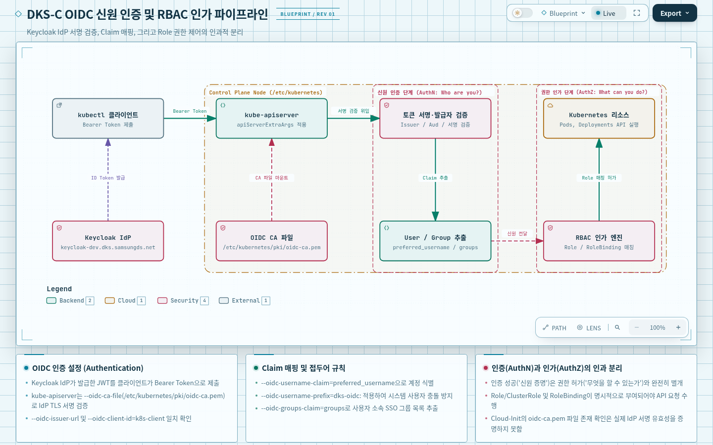
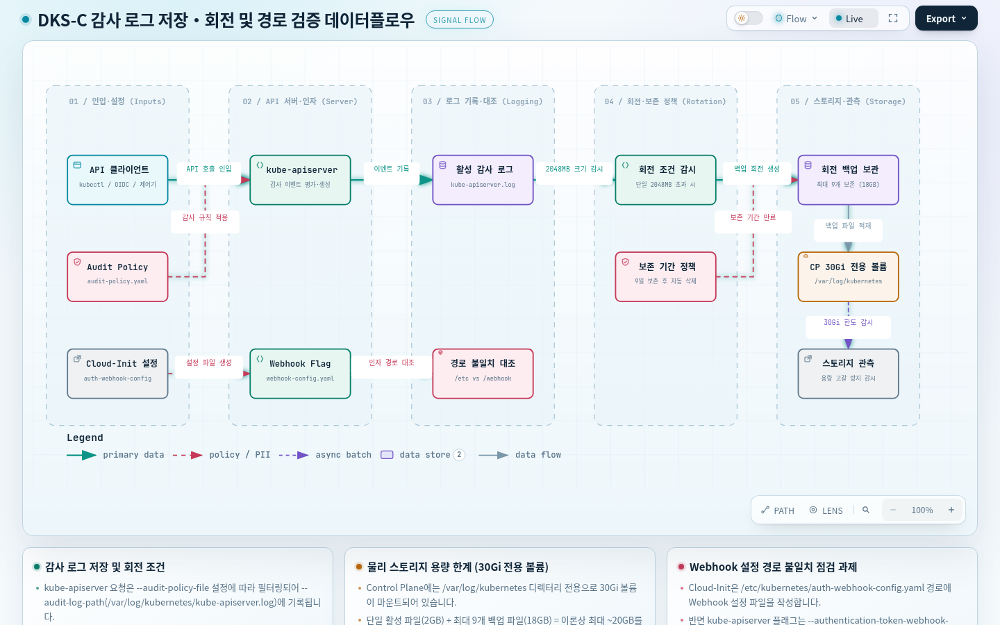
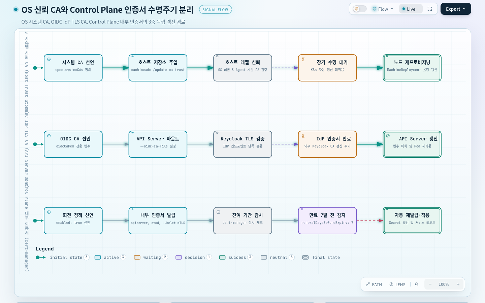
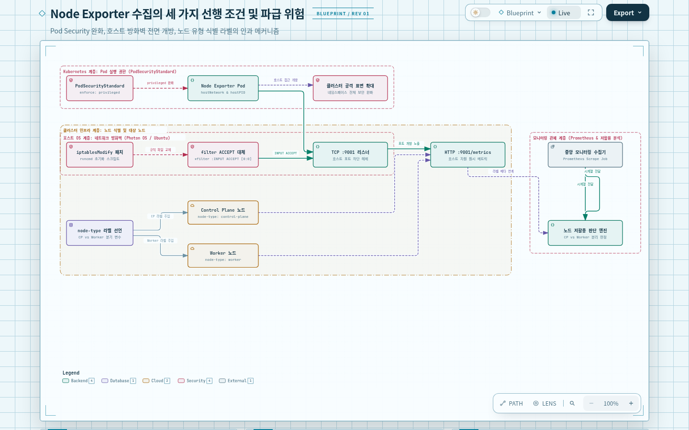
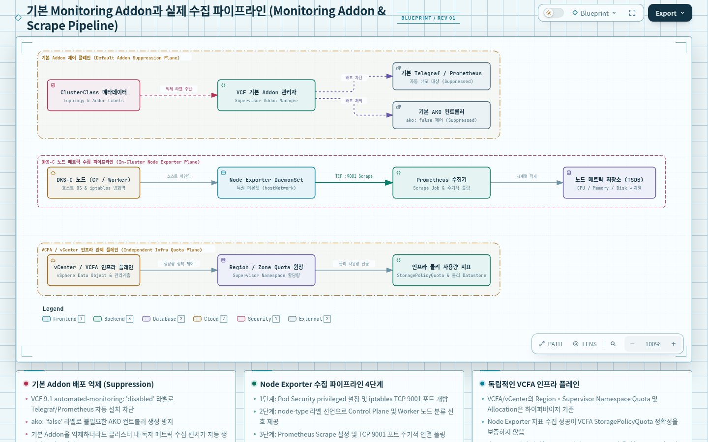

# 05. DKS-C 인증·감사와 노드 메트릭 정책 — 설정은 어떤 통제로 이어지는가?

## 문서의 목적

공장 출입증을 검사하는 장치, 출입 기록을 남기는 장치, 설비 상태를 재는 센서는 모두 안전한 공장 운영에 필요하지만 같은 역할을 하지 않습니다. 출입증 검사가 통과됐다고 작업 이력이 자동 보존되는 것은 아니고, 센서가 설치됐다고 관리실에서 그 값을 자동 수집하는 것도 아닙니다.

이 문서는 DKS-C의 Custom ClusterClass가 적용하려는 **OIDC 인증, 감사 로그, 인증서 신뢰·갱신, Pod/호스트 보안 정책, Node Exporter 메트릭 수집**을 각각 독립된 목적과 실제 적용 경로로 설명합니다. Kubernetes **Cluster**는 요청을 받아 상태를 관리하는 Control Plane과 Pod(컨테이너 실행 단위)를 구동하는 Worker Node의 묶음이고, **API Server**는 그 클러스터를 조회·변경하려는 요청이 들어오는 접점입니다. DKS-C의 **Custom ClusterClass**는 여러 클러스터에 적용할 공통 정책과 사용자 정의 변수를 담는 설계이고, **Patch**는 그 변수·설정값을 Control Plane/Worker용 초기화 템플릿의 특정 필드에 반영할 규칙입니다. 따라서 규칙의 존재, 초기화 파일의 생성, 실제 인증·메트릭 수집 성공은 서로 다른 증거를 필요로 합니다.

사용되는 변수·패치의 선언 구조는 [[03. DKS-C ClusterClass 정책 적용]], 노드 부팅 중 적용 위치는 [[04. CAPI Cloud-Init과 Node 부트스트랩]]과 연결하되, 기본 개념과 작동 조건은 이 문서 안에서도 설명합니다.

> 근거 범위: [[DKS-C Provisioning 정책 (CC custom definition)]]의 정책 값·Patch/Metadata 예시와 [[Cluster & Custom ClusterClass Cloud-Init 프로세스]]의 실제 초기화 명령 기록입니다. 이 문서는 해당 설정의 의도와 기술적 영향 범위를 설명한 것이며 현재 운영 클러스터의 API Server 플래그, 방화벽, Node Exporter, 인증서 교체 성공을 신규 점검한 결과는 아닙니다. 인증서 본문·TLS Cipher 전체는 원문에서 생략됐습니다. [S1, S2]

## 전체 인과 지도

출입증에 적힌 이름만으로 입장을 허용하면 위조된 출입증을 구별할 수 없습니다. 출입증을 발급한 기관과 발급 기관의 서명을 신뢰할 수 있어야 합니다. Kubernetes에서도 API Server가 OIDC 토큰의 발급자·대상·서명 검증에 필요한 설정을 받아야 외부 IdP의 신원을 인증에 연결할 수 있습니다.

방문객이 들어올 권한이 있더라도 누가 언제 출입하려 했는지를 나중에 확인하려면 기록 규칙과 저장 공간이 필요합니다. API Server의 Audit Log는 어떤 요청을 어떻게 기록할지 정하는 정책 파일, 어디에 쓸지 정하는 경로, 파일을 언제 회전할지 정하는 옵션이 함께 맞아야 역할을 수행합니다.

관리실이 발급 기관의 서명을 신뢰하는 것과 공장 내부 장비가 서로의 통신 인증서를 신뢰하는 것은 다른 문제입니다. OIDC CA, OS Trusted CA, Control Plane 자체의 인증서 자동 갱신은 대상과 수명주기가 다릅니다. 동일하게 '인증서'라는 단어를 쓴다고 하나의 설정으로 합칠 수 없습니다.

생산 라인의 이상 징후를 보고 싶다면 센서를 달고, 센서의 통신이 허용되도록 하고, 값을 수집할 시스템을 두어야 합니다. DKS-C 문서의 Node Exporter 문제는 Pod Security, 노드의 9001 포트 접근, 노드 유형별 라벨이라는 서로 다른 조건으로 나뉩니다. 그중 한 가지를 해결했다고 메트릭 수집이 완성되는 것은 아닙니다.

### OIDC 신원이 Kubernetes 인증으로 들어오는 경로

공장 출입증이 유효하려면 발급 기관이 누구인지, 해당 공장 출입용인지, 출입증에서 어떤 이름과 소속을 읽을지 정해야 합니다. 출입증을 확인하는 장치에 발급 기관의 인증서가 없는 경우에는 겉모양이 정상이어도 서명을 신뢰할 수 없습니다.

**OIDC(OpenID Connect)**는 사용자가 외부 신원 제공자(IdP, Identity Provider)에서 인증받은 결과를 토큰으로 전달하고 서비스가 그 신원을 검증하도록 하는 방식입니다. DKS-C의 Kubernetes API Server가 토큰을 받으면, 일반적인 OIDC 인증 경로에서는 허용된 **발급자(issuer)**, 토큰이 사용될 **대상(audience/client ID)**, 유효기간, 전자서명 등을 확인합니다. 서명은 발급자의 검증 키와 관련된 문제이고, IdP와 HTTPS로 통신할 때 서버 인증서를 신뢰하는 문제는 별개의 **TLS CA** 문제입니다. 두 검증이 모두 필요할 수 있지만 'CA 파일이 생겼다 = 토큰 서명이 검증됐다'는 인과는 성립하지 않습니다.

Cluster의 `topology.variables.oidc` 값이 ClusterClass의 `apiServerExtraArgs` Patch에 공급돼 API Server의 발급자·대상·Claim 관련 인자로 연결되고, `oidcCaPem` Patch는 `/etc/kubernetes/pki/oidc-ca.pem`을 만들도록 기록됩니다. 여기서 **CA(Certificate Authority)**는 TLS 서버 인증서 체인을 검증할 때 사용하는 신뢰 기관이며, `--oidc-ca-file`은 IdP HTTPS 연결의 TLS 신뢰에 사용하는 파일 경로입니다. 실제 토큰 서명 검증 키를 어디서 가져오는지, 서명이 검증되는지, 클러스터가 특정 OIDC 구성을 활성화했는지는 이 원문에 관측 기록이 없으므로 일반 원리와 운영 사실을 구별해야 합니다. [S1: ‘OIDC’, ‘Patches definitions’, ‘apiServerExtraArgs (oidc)’]




| 원문 Cluster 변수 | API Server 인자 | 그 인자가 지정하는 기준 |
|---|---|---|
| `oidc.enabled: true` | OIDC 옵션 적용 여부를 결정하는 Cluster 변수 | Patch 조건에 따라 인증 연동 구성 사용 |
| `issuerUrl` | `--oidc-issuer-url` | 허용할 토큰 발급자 |
| `clientId` | `--oidc-client-id` | 해당 Kubernetes API의 토큰 대상 |
| `usernameClaim` | `--oidc-username-claim` | 사용자 이름으로 읽을 Claim |
| `usernamePrefix` | `--oidc-username-prefix` | Kubernetes에 매핑할 사용자 이름 접두어 |
| `groupsClaim` | `--oidc-groups-claim` | 토큰에서 Group으로 사용할 Claim |
| `capemBase64` | `--oidc-ca-file=/etc/kubernetes/pki/oidc-ca.pem` | IdP TLS 인증서 검증을 위한 CA 파일 생성·참조 |

원문 예시의 실제 인자와 값은 다음과 같습니다. 이 값들은 **DKS-C 개발용 IdP를 가리키는 문서 예시**이며 운영 클러스터가 현재 동일 발급자를 사용한다고 확정하지 않습니다. CA 인증서 데이터는 원문 일부가 절단돼 있으므로 복제하지 않습니다.

```text
--oidc-issuer-url=https://keycloak-dev.dks.samsungds.net/realms/DKS
--oidc-client-id=k8s-client
--oidc-username-claim=preferred_username
--oidc-username-prefix=dks-oidc:
--oidc-groups-claim=groups
--oidc-ca-file=/etc/kubernetes/pki/oidc-ca.pem
```

검사 장치에 출입증 발급 기관의 이름만 등록하고 실제 인증서를 설치하지 않으면 연동이 성립했다고 볼 수 없습니다. 원문 Control Plane의 Cloud-Init에는 OIDC CA 파일이 생성될 때까지 `until [ -f ...oidc-ca.pem ]`으로 기다리는 단계가 있습니다. 이는 파일 존재 조건이며 **정상 인증 시험**을 대신하지 못합니다. Worker에도 `oidcCaPem` 패치가 정의된 것으로 나타나지만, API Server OIDC 토큰 검증과 Worker kubelet의 클러스터 가입 인증을 같은 메커니즘으로 취급하면 안 됩니다. Worker의 별도 CA 대기 명령은 발췌에 없으며 그 의미는 실제 생성된 cloud-config에서 확인해야 합니다. [S2: ‘Control Plane runcmd’, ‘Workers runcmd’]

토큰이 진짜인지 확인하는 **인증(Authentication)**과 그 사용자가 어떤 API 작업을 할 수 있는지 결정하는 **인가(Authorization)**는 별도 단계입니다. 토큰의 `usernameClaim`과 `groupsClaim`은 사용자 이름·소속 그룹을 Kubernetes의 사용자 식별 정보로 옮길 때 쓰고, `usernamePrefix`는 이름 충돌을 줄이도록 접두어를 붙입니다. **Role**은 Namespace 등에서 허용할 API 작업을 정의하고, **RoleBinding**은 그 권한 규칙을 사용자·그룹에 묶는 Kubernetes의 RBAC(역할 기반 접근 제어) 리소스입니다. 그러므로 유효한 OIDC 토큰을 얻었다고 모든 Kubernetes API에 접근할 수 있는 것이 아닙니다.

원문에는 실제 토큰의 발급자·대상·서명·만료 검증 및 RBAC 허용 결과가 기록되지 않았습니다. 따라서 API Server의 OIDC 인자와 CA 파일을 확인하는 일은 인증 **설정**의 증거이고, 정상·비정상 토큰을 넣어 요청이 허용·거부되는지 확인하는 일은 인증·인가 **동작**의 별도 증거입니다. [S1: ‘OIDC’, ‘apiServerExtraArgs’]

### 감사 로그가 저장·회전되는 조건

출입문에 출입 기록장치를 달아도 기록할 사건의 범위가 정해지지 않았거나 기록 저장 장치가 꽉 차면 원하는 추적이 되지 않습니다. 회전 주기가 있어도 저장 경로와 기록할 파일이 서로 연결되지 않으면 보존 정책이 완결되지 않습니다.

Kubernetes API Server의 **Audit Log**는 API에 누가 어떤 요청을 보냈고 처리 과정에서 무엇이 일어났는지 추적하기 위한 기록입니다. 로그인 검증이나 접근 허용 자체를 대신하는 기능이 아니며, 사고 조사·변경 추적을 위해 독립적으로 필요합니다. 기록은 **어떤 요청·어느 단계·어느 수준으로 남길지** 정하는 Audit Policy, **어디에 기록할지** 정하는 로그 경로, **기록 파일을 어느 크기·기간·개수로 순환할지** 정하는 회전 옵션에 의해 달라집니다. 요청이 허용되지 않더라도 Audit Policy가 포함하는 조건에 따라 거부된 요청의 기록을 남길 수 있으므로, 정책 파일 내용 없이 '모든 접근이 전부 기록된다'고 단정하지 않습니다.

원문은 `--audit-policy-file=/etc/kubernetes/extra-config/audit-policy.yaml`, `--audit-log-path=/var/log/kubernetes/kube-apiserver.log`와 다음 세 값을 기록합니다. [S1: ‘AUDIT LOG’, ‘auditLog’, ‘apiServerExtraArgs’]



| 변수/인자 | 원문 값 | 영향을 주는 기능 |
|---|---|---|
| `auditLog.maxSize` → `--audit-log-maxsize` | `2048` | 감사 로그 파일 한 개의 최대 크기(MB로 해석하는 kube-apiserver 옵션) |
| `auditLog.maxAge` → `--audit-log-maxage` | `9` | 오래된 로그 보관 기간(일 단위 옵션) |
| `auditLog.maxBackup` → `--audit-log-maxbackup` | `9` | 회전 후 유지할 백업 파일 수 |

원문에는 비교 대상으로 `maxsize 100`, `maxage 30`, `maxbackup 10`을 'default'라고 기록합니다. 이 기본값 역시 **원문이 비교한 대상 버전의 기록**으로 취급해야 하며 다른 kube-apiserver 버전의 기본값을 단정하지 않습니다. 실제 정책 파일에 어떤 API 경로·사용자가 어느 Audit Level로 포함되는지 원문 전문이 없어, 요청이 기록된다고 해도 어떤 필드가 남는지까지 확정하지 않습니다.

기록 장치의 보존 정책은 저장 장소의 용량과 맞아야 합니다. DKS-C Control Plane Volume 예시에는 `/var/log/kubernetes`용 30Gi Storage가 있고, 로그 경로는 그 안의 `kube-apiserver.log`입니다. 그러나 최대 크기 2048과 백업 수 9를 읽고 로그 총량이 정확히 18Gi로 고정된다고 단정할 수는 없습니다. 현재 파일, 회전 과정, 압축 여부, 다른 로그와 저장 공간의 공유, 정책 버전 등의 조건이 남기 때문입니다. Audit 파일 회전이 설정돼도 실제 공간 부족과 로그 수집·외부 보존 성공은 별도로 관측해야 합니다. [S1: ‘controlPlane — volumes’; S2: ‘Control Plane write_files’]

API Server에는 감사 외에도 초기화 파일을 필요로 하는 인자가 있습니다. 원문은 `--admission-control-config-file=/etc/kubernetes/extra-config/admission-control-config.yaml`, `--encryption-provider-config=/etc/kubernetes/extra-config/encryption-provider-config.yaml`, `--authentication-token-webhook-config-file=/webhook/webhook-config.yaml`, `--authentication-token-webhook-version=v1`, `--enable-admission-plugins=NamespaceLifecycle,NodeRestriction,PodSecurity,ServiceAccount`, `--runtime-config=authentication.k8s.io/v1beta1=true`, `--goaway-chance=0`, `--tls-min-version=VersionTLS12`를 기록합니다. `--tls-cipher-suites`의 목록은 원문에서 잘려 있어 정확한 최종 집합으로 전사할 수 없습니다. [S1: ‘apiServerExtraArgs (OIDC·audit-log 제외)’]

출입 기록기의 설정 파일 경로와 실제 부팅 과정에서 만드는 경로가 다르면 파일이 어디에 놓였는지를 확인해야 합니다. 원문 Cloud-Init은 `/etc/kubernetes/auth-webhook-config.yaml`을 파일 목록에 적었지만, API Server 인자는 `/webhook/webhook-config.yaml`을 가리킵니다. 이 차이가 Volume 마운트나 별도 복사로 해결되는지는 현재 기록만으로 알 수 없습니다. **두 경로의 실제 파일 존재·마운트·API Server 매개변수**를 대조해야 하며, 곧바로 구성 오류라고 확정하지 않습니다. [S1, S2]

### OS 신뢰 CA와 Control Plane 인증서 갱신

공장 밖 출입증 발급 기관을 신뢰하는 문제와 공장 내부 장비들의 신뢰 기관을 갱신하는 문제는 다릅니다. 같은 '인증서'를 쓴다고 두 문제의 유효기간과 설치 위치가 하나가 되지는 않습니다.

공장 내부 장비가 사내 배포 서버나 Registry와 HTTPS로 통신하려면, 상대 서버가 내놓는 인증서의 발급 기관을 신뢰해야 할 수 있습니다. **Trust Store(신뢰 저장소)**는 OS나 프로그램이 신뢰하는 CA 인증서 집합을 뜻하며, 이를 채우는 일은 인증서를 새로 **발급**하거나 이미 발급된 인증서의 **만료일을 연장**하는 일과 다릅니다.

DKS-C의 `osConfiguration.trust.additionalTrustedCAs`는 VM 운영체제에 추가 신뢰 CA를 주입하려는 변수로, 원문은 `SECDS-ROOTCA.crt`, `SECDS-T2RootCA.crt`, `SECDS-T2IssuingCA.crt` 세 가지를 명시합니다. 초기화의 `machineadm` 설정에서는 `spec.systemCAs`로 연결되는 기록이 있습니다. 이는 VM OS 및 기초 Agent의 신뢰 저장소와 관련된 경로입니다. 반면 `oidcCaPem`은 API Server가 외부 OIDC 발급자의 TLS 체인을 확인하도록 만드는 별도의 경로입니다. 둘의 인증서가 같은지, 어느 저장소에 실제 반영됐는지는 이름만으로 단정할 수 없습니다. [S1: ‘TrustedCA’, ‘osConfiguration’; S2: ‘VMware Machine Agent 관련’]

인증서가 만료되기 전에 새 인증서를 요청하도록 해도 실제 갱신과 서비스 적용에 성공했는지는 별도입니다. 원문의 `kubernetes.certificateRotation.enabled: true`, `renewalDaysBeforeExpiry: 7`은 **Control Plane 인증서 만료 최소 7일 전에 갱신을 시작하도록 하는 정책 의도**로 기록되고, cert-manager를 관련 요소로 설명합니다. 설정값이 실제로 어떤 인증서 종류에 적용되는지, 재발급 결과가 어떤 서비스에 반영되는지는 해당 ClusterClass/VKS 버전과 운영 관측이 필요합니다. 이것을 OS Trusted CA 세 개나 OIDC IdP 인증서의 자동 갱신 보장으로 확대하지 않습니다. [S1: ‘Certificate Rotation’, ‘kubernetes variables’]



### Node Exporter의 세 가지 선행 조건

공장 설비에 온도 센서를 달려면 설치 허가를 받아야 하고, 센서가 외부 관제실까지 통신할 수 있어야 하며, 관제실이 어느 설비에서 온 값인지 식별해야 합니다. 허가·통신·식별 중 하나라도 빠지면 센서가 있어도 관측 서비스가 완성되지 않을 수 있습니다.

**Node Exporter**는 노드 OS·커널의 CPU·메모리·디스크·네트워크 관련 상태를 메트릭으로 노출하는 수집 대상 프로그램입니다. Exporter가 HTTP 등으로 지표를 노출하더라도 이를 실제로 가져가는 **Scraper(수집기)**, 네트워크 경로와 저장·조회 체계가 없으면 운영 화면에서 추이를 볼 수 없습니다. 이 설명은 일반적인 수집 원리이지, 현재 DKS-C 배포에 어떤 수집기가 설치됐는지의 확인 결과는 아닙니다.

DKS-C 원문은 **VKS(vSphere Kubernetes Service)** 클러스터의 Node Exporter 관련 제약을 세 가지로 기록합니다. **(1) PodSecurity Standard Restricted로 인한 Pod 생성 제한, (2) Photon OS(VMware Linux 계열 노드 OS)의 9001번 포트 접근 차단, (3) 저활용 판단을 위한 Control Plane/Worker 노드 유형 라벨 필요**입니다. **Pod Security Standard(PSS)**는 Kubernetes Pod에 허용할 보안 수준을 정하는 기준이며, `restricted`는 강한 Pod 보안 제약을 적용하는 프로파일이고, `privileged`는 Pod Security Admission의 해당 제한을 거의 적용하지 않는 프로파일입니다. `privileged`로 설정한다고 개별 Pod에 특권이 자동 부여되는 것은 아니지만, 이전에 차단되던 위험한 Pod 구성도 이 프로파일 기준으로는 허용될 수 있습니다. `enforce`는 허용·거부 판단에, `audit`와 `warn`은 위반 관측·경고에 쓰는 서로 다른 정책 모드입니다. 어느 Namespace와 Pod에 이 값이 실제 적용되는지는 원문 변수만으로 확정할 수 없습니다. 원문이 제안한 대책은 아래처럼 서로 다른 계층에 적용됩니다. [S1: ‘VKS 클러스터 메트릭 수집 이슈 해결’, ‘Patches definitions’]



| 문제가 나타나는 계층 | 원문에 정의된 조치 | 그 조치만으로 보장되지 않는 것 |
|---|---|---|
| Kubernetes Pod Security | `kubernetes.security.podSecurityStandard`의 `enforce/audit/warn: privileged`, `deactivated: false` | 해당 Exporter Pod가 실제 실행·정상 수집된다는 사실 |
| 노드 호스트 방화벽 | `iptablesModify` Patch를 Control Plane·Worker 초기화에 적용 | Pod 생성 성공, 필요한 수집기/라우팅/정책 |
| 노드 유형 식별 | `node-type: control-plane`, `node-type: worker` 라벨 | 실제 메트릭 정확성이나 활용률 평가 알고리즘 |

허용 정책을 넓혀서 센서 설치를 가능하게 하면 원래 금지하던 다른 작업도 허용될 수 있습니다. `privileged` 수준의 PodSecurityStandard는 'Node Exporter Pod 하나만 허용'하는 세밀한 예외와 같지 않습니다. 적용 범위의 Pod와 Namespace, 다른 보안 요구를 확인하지 않고 제한을 해제하는 해결책으로 일반화하면 안 됩니다.

또한 원문의 `iptablesModify`는 9001 포트를 선택적으로 `ACCEPT` 하는 규칙을 추가하는 형태가 아닙니다. Photon OS에서는 `/etc/systemd/scripts/ip4save`, Ubuntu에서는 `/etc/iptables/rules.v4` 경로를 선택하고, 기존 파일을 삭제한 다음 아래 `filter` 정책을 쓴 뒤 `iptables-restore`로 적용합니다. 이 변화는 9001 포트 이외의 호스트 방화벽 동작도 바꿀 수 있다는 뜻입니다. [S2: ‘Control Plane/Workers runcmd’]

```text
*filter
:INPUT ACCEPT [0:0]
:FORWARD ACCEPT [0:0]
:OUTPUT ACCEPT [0:0]
COMMIT
```

여기서 "접속 불가 문제 해결"이라는 설계 의도와 "어떤 기존 규칙까지 교체하는지"라는 실제 효과를 구별해야 합니다. 기존 iptables 정책을 보존해야 하는 요구가 있다면, 현행 배포의 관리 경로·실제 규칙·재부팅 뒤 유지 여부를 확인한 뒤 더 좁은 대안을 검토해야 합니다. 원문의 스크립트만 보고 방화벽의 전체 상태가 항상 동일하다고 단정하거나 운영 환경에 그대로 재실행하지 않습니다.

수집기가 센서의 측정값을 읽어 오더라도 어느 공장의 어느 기계인지 분류할 수 없으면 활용률 비교가 어려워집니다. `node-type`은 Kubernetes Node에 부여하는 **Label(키·값 식별 표지)**로, Control Plane과 Worker를 나눠 집계하거나 운영 정책에 반영할 때 사용할 수 있습니다. 하지만 라벨 자체가 Node Exporter를 설치하거나 Scrape 대상을 등록·수집하는 일은 하지 않습니다. `node` 변수 위치를 Control Plane 쪽으로 이동해야 한다는 미완료 메모도 원문에 남아 있으므로, **라벨의 선언 위치와 실제 Node Label**을 확인해야 합니다. [S1: ‘controlPlane variables’, ‘workers.machineDeployments’, ‘주의사항’]

### 기본 Monitoring Addon과 실제 수집 파이프라인

공장에 기본 관제 장비를 설치하지 않기로 했다고 해서 독자적인 센서가 자동으로 생기는 것은 아닙니다. 반대로 기본 장비를 끄는 설정과 다른 회사 센서의 데이터 수집은 독립적인 운영 판단입니다.

**Addon**은 클러스터 운영에 필요한 기능을 추가 설치·관리하는 구성요소입니다. **Telegraf**는 여러 출처의 메트릭을 수집·전달하는 에이전트 유형이고, **Prometheus**는 수집 대상의 지표를 읽어 저장·질의하는 모니터링 시스템입니다. **AKO**는 Kubernetes와 VMware 로드밸런서/네트워크 구성을 연계하는 별도 기능이며, **Cluster Autoscaler**는 Worker Node 수를 워크로드 요구에 맞춰 조절하는 기능입니다. 서로 다른 기능이므로 설치를 제외하거나 관리하겠다는 메타데이터도 각각 별도 정책으로 읽어야 합니다.

원문은 VCF 9.1부터 기본 Monitoring Addon(telegraf, prometheus)이 자동으로 추가될 수 있어 `addons.kubernetes.vmware.com/automated-monitoring: "disabled"` 라벨로 설치를 제외하도록 기록합니다. 또한 `ako.kubernetes.vmware.com/install: "false"`로 AKO 설치 제외를, `addon.addons.kubernetes.vmware.com/cluster-autoscaler: managed`로 Autoscaler 관리를 제시합니다. 이 셋은 **서로 다른 애드온/기능에 관한 제어**이며, 'Monitoring disabled'를 '클러스터에서 메트릭 수집이 전혀 없다'는 결론으로 바꿀 수 없습니다. [S1: ‘Cluster Metadata’, ‘주의사항’]

센서를 설치했다는 사실, 센서의 포트에 접근할 수 있다는 사실, 실제 데이터를 수집하고 저장한다는 사실은 서로 다른 검증 단계입니다. Node Exporter의 Pod 상태·해당 노드에서의 TCP 연결·Scrape 대상 등록·시계열 샘플 유입을 각각 확인해야 '저활용 판단에 사용할 메트릭'까지 연결할 수 있습니다. 구체적으로 어떤 중앙 저장소와 수집기가 사용되는지는 이번 두 원문만으로 확정할 수 없으므로 임의의 Prometheus 배치 구조를 만들지 않습니다.

또한 Node Exporter가 제공하는 노드 자원 지표와 VCFA/vCenter가 제공하는 **Region·Supervisor Namespace Allocation/Utilization**은 출처와 의미가 다릅니다. Node Exporter 데이터가 들어온다고 VCFA StoragePolicyQuota나 Namespace별 물리 Storage 사용량이 자동으로 생성되는 것은 아닙니다. 자원 측정의 한계와 임계치는 [[01. VCF 자원 할당과 실제 사용]], [[02. VCF Quota 동기화와 모니터링 판단]]의 별도 판단 기준으로 유지합니다.



### 정책 적용을 주장하기 위한 증거

출입 검사가 정상인지, 기록이 남는지, 온도 센서가 작동하는지는 각 장치의 설치 도면을 보는 것만으로 입증되지 않습니다. 업무 기능과 관측 결과를 연결해야 실제 운영 판정을 내릴 수 있습니다.

| 확인하려는 결과 | 선언·파일 단계 | 필요한 실제 관측 |
|---|---|---|
| OIDC 인증 | `oidc` 변수, `oidcCaPem` 파일, API Server 인자 | 유효·무효 발급자/대상 토큰에 대한 인증 동작, 기대 User/Group |
| 감사 기록·보존 | Audit Policy/Path/회전 인자, Control Plane 로그 Volume | API 요청의 감사 기록, 파일·회전·용량 상태 |
| 인증서 갱신 | Rotation 설정과 인증서 목록 | 대상 인증서 유효기간 변화, 실제 서비스 반영 |
| Trusted CA 적용 | `additionalTrustedCAs`, `systemCAs` | Node의 실제 신뢰 저장소, 지정 서버 TLS 검증 |
| Node Exporter 수집 | Pod Security·iptables·node-type·Addon 라벨 | Pod Ready, 포트 연결, Scrape 성공, 시계열 유입 |
| 기본 Addon 제외 | `automated-monitoring: "disabled"` | 실제 기본 Telegraf/Prometheus Addon 생성·동작 여부 |

이 표는 현행 환경 검증의 **질문 목록**이지 실제 시험이 성공했다는 보고가 아닙니다. 특히 'Node Exporter 9001 연결 성공'을 '인프라 Utilization 정확'으로, 'PodSecurity privileged'를 '정책상 안전'으로, '인증서 갱신 시작 7일 전'을 '갱신 완료 7일 전'으로 바꾸어 결론내리지 않는 것이 회의에서 필요한 경계입니다.

## 질문별 자료 안내

| 표기 | 근거가 답하는 질문 | Obsidian 자료 |
|---|---|---|
| S1 | OIDC·Audit·인증서·PSS·Addon·노드 라벨을 어떤 ClusterClass/Cluster 변수와 패치로 정의했는가? | [[DKS-C Provisioning 정책 (CC custom definition)]] — ‘DKS-C 적용 정책 요건’, ‘Cluster Metadata’, ‘topology.variables’, ‘Patches definitions’, ‘apiServerExtraArgs’ |
| S2 | CA 파일·iptables·kubelet 권한이 부팅 과정에서 어디에 놓이고 무슨 명령으로 실행되는가? | [[Cluster & Custom ClusterClass Cloud-Init 프로세스]] — ‘Control Plane cloud-config’, ‘Workers cloud-config’, ‘주의사항’ |
| S3 | Node 메트릭과 다른 Region/Namespace Utilization의 정의·한계는 무엇인가? | [[VCF 9.1 인프라 Utilization 모니터링]] — ‘비율(%) 계산’, ‘vCenter Data Object’, ‘Supervisor Namespace 계산식’ |

이 문서의 항목들은 동시에 여러 계층에 영향을 줄 수 있으나 번호 순서대로 실행되는 하나의 파이프라인은 아닙니다. ClusterClass 구성·Cloud-Init·API Server·Node·중앙 관측 시스템에서 각각 자신의 상태를 확인해야 **정책이 선언됐다**와 **효력이 검증됐다**를 구별할 수 있습니다.