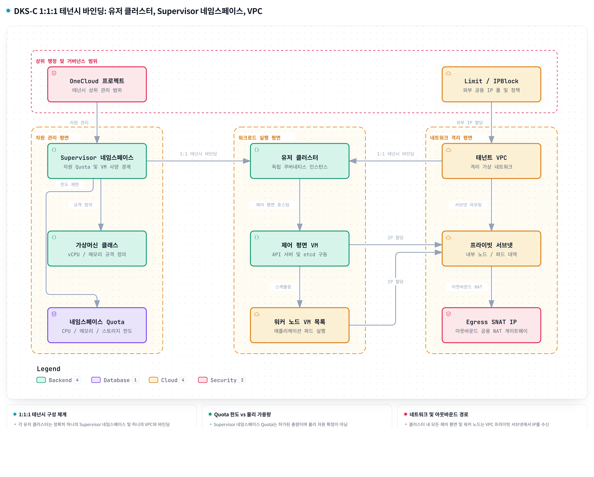
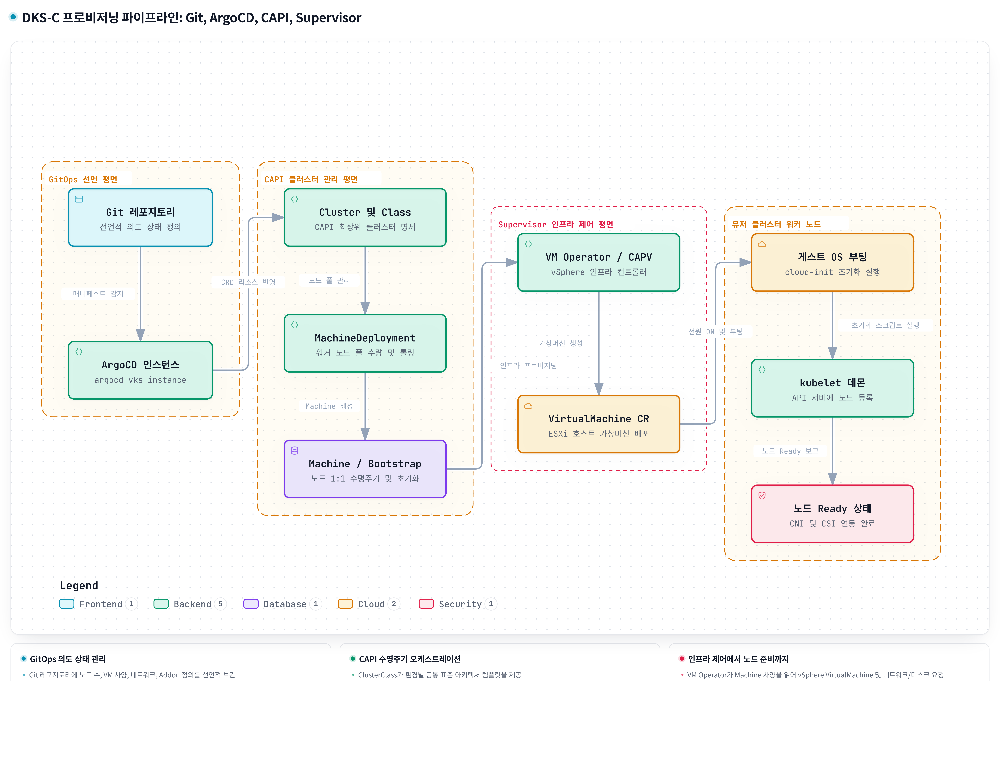
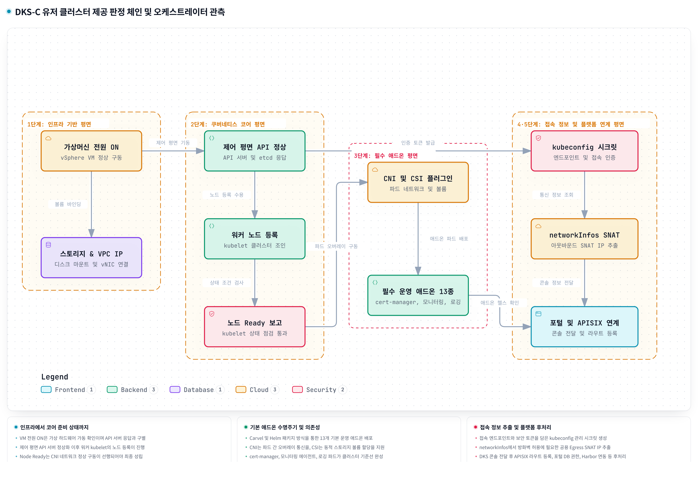

# 01. 멀티클러스터 테넌시와 자동 프로비저닝 — 무엇이 분리되고 생성 완료는 어디까지인가?

## 문서의 목적

한 건물의 사무실을 회사별로 나누는 것과 회사마다 건물을 따로 마련하는 것은 다릅니다. 건물을 따로 마련해도 사용할 전력과 도로를 배정해야 하고, 설계와 허가가 준비돼도 실제 공사와 입주 준비가 남습니다. 이 차이를 구분해야 “구획을 만들었다”는 사실을 “독립된 업무 환경을 사용할 수 있다”는 뜻으로 잘못 받아들이지 않습니다.

이 문서는 DKS-C에서 Namespace와 User Cluster가 각각 무엇을 나누는지, Supervisor Namespace와 VPC가 어떤 인프라 범위를 연결하는지, Git·ArgoCD·CAPI·Supervisor가 선언을 실제 VM과 Node로 어떻게 이어 가는지 설명합니다. 마지막에는 생성된 리소스와 사용 가능한 Cluster를 구분하는 상태 및 조사 기준까지 연결합니다.

비유는 문서 전체에서 **신도시 개발**로 통일합니다. Cluster는 건물 전체, Namespace는 회사별 사무실 구획, Control Plane은 관리실, Worker Node와 그 VM은 건물 안의 작업 구역 및 그 구역을 구성하는 설비에 대응합니다. 건물을 뒤에서 VM 한 대로 바꾸어 부르지 않습니다. 실제 Namespace는 물리적 방이나 Node 배치를 고정하는 장치가 아니라는 차이는 기술 설명에서 구분합니다.

> 자료 범위: 지정된 DKS-C 01 원문과 그 원문에 인용된 운영·CCI·인프라·SW 자료의 기록을 재구성했습니다. 배치 수치와 내부 구성은 해당 기록의 범위이며, 이번 재작성에서 운영 환경을 신규 조회한 결과는 아닙니다. [S1–S4]

## 전체 인과 지도

회사가 같은 건물의 서로 다른 사무실을 쓰면 공간과 출입 규칙은 나눌 수 있지만 관리실과 공용 설비는 계속 공유합니다. 건물 자체의 운영까지 회사별로 나누려면 별도의 건물이 필요합니다.

Namespace는 하나의 Kubernetes Cluster 안에서 리소스를 구분합니다. 권한과 자원 한도는 별도 설정으로 연결하지만, Cluster의 제어 기능과 Worker 집합을 Namespace마다 새로 만들지는 않습니다. 이보다 큰 운영 경계가 필요할 때 DKS-C는 자체 Control Plane과 Worker 집합을 가진 User Cluster를 사용합니다.

건물이 독립돼도 사용할 전력의 허용량과 연결할 도로는 따로 정해야 합니다. 자원 허가와 도로 배정은 건물의 운영 경계를 실제 기반시설에 연결하는 일입니다.

DKS-C의 기록에서는 User Cluster마다 Supervisor Namespace와 VPC를 하나씩 연결합니다. Supervisor Namespace는 VM이 사용할 자원 한도와 VM Class를, VPC는 IP와 가상 Network 범위를 연결합니다. 이 대응이 정해져도 실제 물리 용량이 남아 있는지와 목적지까지 통신할 수 있는지는 별도의 조건입니다.

허가서와 설계도가 있다고 건물과 내부 설비가 완성되는 것은 아닙니다. 설계와 현장 상태를 계속 비교해 부족한 부분을 만들고, 완성된 시설을 실제 운영 체계에 참여시켜야 합니다.

Git의 정의를 ArgoCD가 관리 API에 반영하면 CAPI와 인프라 Controller들이 필요한 Machine·VM·Storage·Network를 조정합니다. VM 안에서는 초기화와 kubelet의 Node 등록이 이어집니다. 이 작업들은 각자의 의존 조건에 따라 겹쳐 진행될 수 있으며, 한 Controller의 상태를 다른 모든 작업의 완료로 읽을 수는 없습니다.

건물 골조, 관리실 가동, 작업 구역 준비, 입주자의 출입 수단은 각각 다른 완료 지점입니다. 어느 하나가 준비돼도 나머지가 없으면 실제 입주가 막힐 수 있습니다.

User Cluster도 VM 존재, Kubernetes API 응답, Worker 등록, Node Ready, Addon 상태, 접속 정보와 Portal·Console 후처리를 나누어 확인해야 합니다. 이 구분을 통해 “어느 리소스까지 만들어졌는가”와 “사용자가 어디까지 사용할 수 있는가”를 연결할 수 있습니다.

### Namespace와 User Cluster

![[01_namespace_user_cluster.png]]

한 건물에서 A회사와 B회사가 모두 ‘접수실’이라는 이름의 방을 쓸 수 있습니다. 회사 구획이 다르면 같은 방 이름도 서로 다른 장소를 가리킵니다. 그러나 방 이름이 구별된다고 건물이 두 채가 되는 것은 아닙니다.

Namespace는 하나의 Kubernetes Cluster 안에서 Pod·Service 같은 **namespaced Resource**의 소속을 구분합니다. Pod는 컨테이너를 실행하는 단위이고, Service는 대상 Pod로 통신을 연결하는 접속 지점입니다. 같은 종류와 같은 이름의 리소스라도 Namespace가 다르면 별개의 대상으로 관리됩니다. 예를 들어 `dev/web` Service와 `prod/web` Service는 이름이 `web`으로 같아도 서로 다릅니다. [S1]

사무실을 나눈 뒤에도 각 회사가 사용할 수 있는 면적과 누가 어떤 문을 열 수 있는지는 별도로 정해야 합니다. 구획 표지판만 붙였다고 출입 허가와 사용 한도가 자동으로 생기지는 않습니다.

Namespace 생성도 CPU·Memory 한도나 사용자 권한을 자동으로 구성하지 않습니다. ResourceQuota는 해당 Namespace에 허용할 Pod의 CPU·Memory request/limit 합계나 리소스 개수 등에 한도를 둡니다. Role은 ‘Pod 조회’, ‘Deployment 변경’ 같은 허용 작업을 정의하고, RoleBinding은 그 규칙을 사용자·Group·ServiceAccount에 연결합니다. 이 역할 기반 권한 체계가 RBAC입니다. ResourceQuota의 한도를 Namespace 전체의 실시간 CPU 사용률을 직접 조절하는 장치로 해석하거나, RoleBinding 하나가 다른 경로의 모든 권한을 없앤다고 읽어서는 안 됩니다.

회사가 별도 사무실을 쓰더라도 건물의 관리실과 공용 작업 설비는 함께 사용할 수 있습니다. 사무실 배정표와 실제 작업자가 사용하는 설비 배치는 다른 문제입니다.

Kubernetes의 Control Plane은 Cluster 상태와 API를 관리하는 영역입니다. API Server가 요청을 받아들이고 etcd가 Cluster 상태를 저장합니다. Worker Node는 Pod를 실행하는 서버이며, DKS-C에서는 이를 VM, 즉 가상 컴퓨터로 구성합니다. 여러 Namespace는 같은 Cluster의 API Server와 etcd를 사용하고, 서로 다른 Namespace의 Pod가 같은 Worker Node에 배치될 수도 있습니다. Namespace만으로 Node별 전용 배치나 네트워크 차단까지 정해지는 것은 아닙니다.

```text
하나의 Kubernetes Cluster — 소속과 공유 관계
├─ Control Plane
│  ├─ API Server
│  └─ etcd
├─ Worker Node
│  ├─ Namespace A 소속 Pod
│  └─ Namespace B 소속 Pod
└─ 논리적 구획
   ├─ Namespace A
   └─ Namespace B

Namespace 소속과 Pod의 실제 Node 배치는 서로 다른 구분이다.
```

건물 관리실이나 공용 설비를 정비할 때는 사무실이 나뉘어 있어도 여러 회사가 영향을 받을 수 있습니다. 그렇다고 관리실에 문제가 생기는 순간 모든 방의 업무가 반드시 멈추는 것은 아니며, 어떤 설비와 업무가 연결돼 있는지에 따라 영향이 달라집니다.

같은 Cluster의 Namespace들은 Control Plane 문제, Cluster 업그레이드, 함께 사용하는 Worker 장애의 영향을 공유할 수 있습니다. 따라서 Namespace는 ‘한 Cluster 안에서 팀별 리소스와 관리 범위를 나누는 요구’를 해결하지만, Cluster 자체의 수명주기와 실행 기반까지 독립적으로 운영해야 하는 요구를 대신하지는 못합니다.

회사마다 관리실과 작업 구역을 따로 운영해야 한다면 같은 건물에 칸막이를 더 세우는 대신 건물을 분리해야 합니다. 별도 건물의 설비를 교체하는 작업은 다른 건물의 설비를 직접 교체하는 작업과 구분됩니다.

DKS-C의 **User Cluster는 자체 Control Plane과 Worker VM 집합을 가진 별도의 Kubernetes Cluster**입니다. 각 User Cluster의 Kubernetes 상태, Node 수, Machine 교체, 업그레이드를 다른 User Cluster와 별도로 관리할 수 있습니다. Machine은 Node 한 대의 생성·교체를 추적하는 관리 리소스이며, 그 실제 동작은 뒤의 프로비저닝 설명에서 연결합니다. 한 User Cluster의 Machine이나 Node를 조정하는 것이 다른 User Cluster의 같은 리소스를 직접 변경하는 구조는 아닙니다. [S1, S2]

```text
User Cluster A                    User Cluster B
├─ Control Plane A                ├─ Control Plane B
└─ Worker VM 집합 A               └─ Worker VM 집합 B

Namespace: 한 Cluster 내부의 리소스 구획
User Cluster: 별도의 Kubernetes 실행·수명주기 단위
```

독립된 건물도 같은 도시의 발전소·상하수도·도로를 사용할 수 있습니다. 건물을 나누는 결정과 도시 기반시설을 전용으로 배정하는 결정은 다릅니다.

User Cluster 분리는 물리 인프라 전용 배치와 같지 않습니다. User Cluster VM은 vSphere Workload Domain의 서버와 Storage를 사용할 수 있습니다. Workload Domain은 vSphere 인프라를 묶어 운영하는 범위이고, ESXi는 그 안에서 VM을 실행하는 가상화 호스트입니다. 실제 ESXi 배치와 상위 Network를 확인하지 않고 ‘Cluster가 다르므로 ESXi·Storage·Network도 모두 전용’이라고 확대할 수 없습니다. Kubernetes의 분리는 공통 물리 인프라 장애까지 없애는 보장이 아닙니다. [S3]

건물을 분리하는 방침만으로 그 건물의 전력 한도와 연결할 도로가 정해지지는 않습니다. 이제 독립된 건물이 사용할 기반시설 범위를 연결해야 합니다.

User Cluster의 경계를 이해한 다음에는 그 VM들이 사용할 CPU·Memory·Storage와 Network 범위를 연결해야 합니다. 이것이 Supervisor Namespace와 VPC를 함께 살펴보는 이유입니다. 실제 생성 과정에서 이 범위들은 함께 준비될 수 있으므로, 설명 순서가 ‘건물을 먼저 만든 뒤 인프라를 나중에 배정한다’는 실행 순서를 뜻하지는 않습니다.

### Supervisor Namespace와 VPC



건물의 자원 허가는 얼마만큼의 전력과 저장 공간을 사용할 수 있는지 정하고, 도로·주소 구역은 어디에 연결될지 정합니다. 둘은 같은 건물을 지원하지만 해결하는 문제가 다릅니다.

Supervisor Namespace는 User Cluster VM이 사용할 CPU·Memory·Storage와 허용 VM Class를 연결하는 Supervisor 측 자원 범위입니다. VPC는 VM이 사용할 Private IP와 가상 Network 범위를 제공합니다. 여기서 Supervisor Namespace는 User Cluster 내부의 일반 Namespace와 위치와 역할이 다릅니다. DKS-C의 CCI 자료는 User Cluster마다 이 두 대상을 하나씩 연결하는 **1:1:1 구성**을 기록합니다. Kubernetes나 VPC의 모든 구현에 적용되는 보편적인 개수 규칙은 아닙니다. [S2]

```text
DKS-C 기록의 대응 관계 — 생성 순서가 아님
User Cluster A
├─ 자원 범위: Supervisor Namespace A
│  ├─ CPU / Memory Quota
│  ├─ Storage Quota
│  └─ 허용 VM Class
└─ Network 범위: VPC A
   ├─ Private IP 범위
   └─ 가상 Network

User Cluster : Supervisor Namespace : VPC = 1 : 1 : 1
```

도시의 상위 행정구역은 여러 건물의 허가를 묶어 관리할 수 있습니다. 행정구역 하나가 있다는 이유만으로 그 안의 모든 허가와 건물이 자동으로 짝을 이루지는 않습니다.

Project는 여러 Supervisor Namespace와 Project 권한을 묶는 상위 관리 범위입니다. Limit·IPBlock은 VPC에 필요한 External IP의 할당 정책과 주소 풀을 관리합니다. 각 객체가 결정하는 범위를 구분해야 Project의 존재를 User Cluster와의 1:1 대응으로, IP 할당을 실제 통신 성공으로 오해하지 않습니다. [S2, S3]

| 대상 | 실제로 정하는 범위 | 그 대상만으로 확인되지 않는 것 |
|---|---|---|
| Project | 여러 Supervisor Namespace와 Project 권한 | 특정 User Cluster와의 1:1 대응 |
| Supervisor Namespace | VM에 허용할 CPU·Memory·Storage Quota, VM Class | Zone·Region의 실제 남은 물리 용량 |
| VPC | VM의 IP 대역과 가상 Network 범위 | 목적지 Route와 정책 허용, 실제 통신 |
| Limit·IPBlock | External IP 할당 정책과 주소 풀 | 특정 연결의 NAT 성공 |
| User Cluster | 자체 Control Plane과 Worker 집합 | ESXi·Storage·상위 Network 전용 배치 |

작업 구역 하나에 설치할 설비의 크기와 건물 전체에 허가된 총전력은 다릅니다. 작은 설비 여러 개를 놓으면 개별 크기는 작아도 전체 허가량을 소진할 수 있습니다.

VirtualMachineClass는 **VM 한 대의 CPU·Memory 사양**, Supervisor Namespace Quota는 **그 범위가 사용할 수 있도록 허용된 전체 자원량**입니다. Supervisor Namespace를 처음 만들 때는 SupervisorNamespaceClassConfig에 정의된 기본 Quota와 VM Class 설정을 사용할 수 있습니다. 예를 들어 Worker VM 한 대가 4 vCPU·16 GiB인 경우에도 전체 Quota는 그 한 대의 사양과 같다는 뜻이 아닙니다. Control Plane과 다른 Worker의 요구량까지 해당 자원 한도의 계산 기준에 맞춰 함께 수용해야 합니다. 이 수치는 차이를 설명하는 예시이지 현재 DKS-C의 일괄 VM 사양이 아닙니다.

허가서에 여유가 있어도 발전소에 실제 공급 여유가 없으면 설비를 추가할 수 없습니다. 허용량은 ‘사용해도 되는 양’이고 가용량은 ‘지금 제공할 수 있는 양’입니다.

Quota에 여유가 있다는 사실은 VM 생성의 충분조건이 아닙니다. CPU·Memory는 배치 대상 Zone의 한도와 실제 Capacity, Storage는 Region·Storage Policy의 한도와 사용량에 영향을 받을 수 있습니다. 외부 주소가 필요한 요청에는 Limit·IPBlock의 할당 조건도 적용됩니다. 따라서 허용 범위와 실제 배치·주소 할당 결과를 나누어 읽어야 합니다. [S2, S3]

도로 구역을 배정받았어도 목적지까지 길이 이어져 있고 통행이 허용되어야 이동할 수 있습니다. 외부 도로로 나갈 때 표시할 주소를 받았다는 사실만으로 왕복 이동이 성공한 것은 아닙니다.

VPC가 IP와 가상 Network 범위를 제공해도 실제 통신에는 Route, 정책 허용, 필요시 External IP 할당, SNAT과 반환 경로가 맞아야 합니다. SNAT은 외부로 나가는 패킷의 출발지 주소를 변환하는 동작입니다. 주소 할당 정보와 실제 NAT 세션은 다른 증거이므로 하나로 다른 하나를 대신하지 않습니다. 이 구분은 [02. 네트워크 격리](02.%20%EB%84%A4%ED%8A%B8%EC%9B%8C%ED%81%AC%20%EA%B2%A9%EB%A6%AC%EC%99%80%201-1-1%20%ED%85%8C%EB%84%8C%EC%8B%9C%20%EA%B2%BD%EA%B3%84.md)와 [03. Quota 경계](03.%20Supervisor%C2%B7CCI%20%EC%9D%B8%ED%94%84%EB%9D%BC%20%EC%A0%9C%EC%96%B4%20%ED%8F%89%EB%A9%B4%EA%B3%BC%20Quota%20%EA%B2%BD%EA%B3%84.md)에서 더 자세히 이어집니다.

허가와 연결 범위를 정한 다음에도 실제 공사를 맡는 체계가 필요합니다. 허가서를 검사하는 사람이 서류를 다시 열어 봐야만 공사가 시작되는 것은 아닙니다.

이제 어느 User Cluster가 어느 인프라 범위를 사용할지 설명할 수 있습니다. 그 선언을 실제 VM과 Node 상태로 만들고 계속 유지하는 작업은 ArgoCD·CAPI·Supervisor의 조정 영역입니다. 운영자의 조회는 그 작업을 관측하는 수단이지, 별도 근거 없이 Controller 실행의 선행 조건으로 넣을 수는 없습니다.

### Git·ArgoCD·CAPI·Supervisor



설계도와 현장은 시간이 지나면서 달라질 수 있습니다. 설계에 작업 구역을 더 추가하거나 설비를 교체해야 한다면, 관리자는 원하는 모습과 실제 모습을 반복해서 비교해야 합니다.

운영자가 최종적으로 유지하려고 선언한 구성을 Desired State라고 합니다. 현재 상태를 관찰해 그 정의와의 차이를 줄이는 조정을 **reconcile**이라고 합니다. Git에 Node 수·VM 사양·Network·Addon을 기록하는 일은 원하는 상태를 남기는 것이고, 실제 VM·Node를 만드는 일은 이를 읽는 Controller들이 담당합니다. DKS-C 운영 자료는 VCF Cluster API와 ArgoCD 기반 프로비저닝을 기록하며, SW 자료에는 User Cluster 배포용 `argocd-vks-instance`가 Supervisor Service로 기재되어 있습니다. [S1, S4]

최신 설계가 공사 관리 시스템에 정확히 등록돼도 내부 설비까지 완성됐다는 뜻은 아닙니다. ‘설계 등록 완료’라는 표시는 자신이 담당한 일의 완료만 보여 줍니다.

ArgoCD는 Git의 정의를 관리 대상 API Resource에 반영합니다. `Synced`는 원하는 정의와 관리 대상 Resource가 동기화됐다는 뜻이지, 해당 Resource가 요청한 VM이나 Kubernetes Node가 준비됐다는 뜻은 아닙니다. 실제 생성 상태는 그 Resource를 담당하는 Controller와 인프라 상태에서 이어서 읽어야 합니다.

공사에도 공통 설계, 특정 건물의 계획, 작업 구역 집합의 수량 계획, 개별 설비의 관리대장, 초기 가동 설명서가 따로 있습니다. 개별 설비의 관리대장을 건물 전체와 같은 대상으로 부르면 어느 수준을 교체하는지 혼동하게 됩니다.

CAPI, 즉 Cluster API는 Cluster와 Machine의 생성·확장·교체 수명주기를 Kubernetes 리소스로 관리합니다. Machine은 Node 한 대에 대응하는 관리 단위이며 User Cluster 전체와 같은 단위가 아닙니다. 아래 표에서 BootstrapData는 초기화 데이터의 역할을 가리키며, 모든 환경에서 그 이름의 독립 API Kind가 존재한다고 전제하지 않습니다. [S2]

| 대상 | 이 문서에서 필요한 역할 |
|---|---|
| ClusterClass | 유사한 Cluster를 만들 때 사용하는 공통 구성 틀 |
| Cluster | 생성할 Cluster의 원하는 상태와 관련 참조 |
| MachineDeployment | Worker Machine 집합의 수량과 교체 조정 |
| Machine | Node 한 대의 생성·교체와 연결 상태 추적 |
| BootstrapData | VM이 Kubernetes Node로 참여하도록 초기화하는 설정·명령 |

설비 관리대장에 ‘작업 구역 하나 추가’가 기록돼도 현장에 설비가 놓인 것은 아닙니다. 공사 담당자가 실제 자재와 기반시설을 준비하고 초기 가동까지 이어 가야 합니다.

CAPI Controller는 Cluster·MachineDeployment·Machine 상태를 읽어 원하는 구성에 가깝게 조정합니다. Machine과 연결된 Infrastructure·Bootstrap 설정을 바탕으로 인프라 제공 계층이 Supervisor의 VirtualMachine·Storage·Network 요청으로 이어 가고, VM Operator 같은 Controller가 실제 vSphere VM 작업을 수행합니다. VM이 생성되면 초기화 설정이 적용되고 kubelet이 API Server에 Node를 등록합니다. 이 연결을 통해 관리 Resource, 실제 VM, Kubernetes Node가 서로 다른 상태라는 점이 드러납니다.

전력 설비 팀과 내부 공간 팀은 각자의 준비 조건을 보면서 일합니다. 전체 사업을 한 줄로 설명할 수 있어도 모든 팀이 앞 팀의 모든 작업이 끝나기만 기다리는 것은 아닙니다.

ArgoCD·CAPI·Supervisor·kubelet·Addon Controller는 서로 다른 상태를 지속적으로 조정합니다. 다음 도식은 역할 간 연결을 나타내며, 독립적인 조정 작업을 하나의 동기식 실행 함수로 합친 것이 아닙니다.

```text
원하는 정의: Git
    │ 정의 반영
    ▼
관리 API의 Cluster / MachineDeployment / Machine 등
    │ CAPI·인프라 Controller의 반복 조정
    ├─ 실제 VM·Storage·Network 준비
    └─ 초기화 데이터 준비·적용
          │ 필요한 인프라와 초기화 조건이 갖춰짐
          ▼
     VM 안의 kubelet → 해당 Cluster API에 Node 등록

ArgoCD, CAPI, 인프라 Controller, Addon Controller의 조정은
각자의 대상과 의존 조건에 따라 겹쳐 진행될 수 있다.
운영자의 상태 조회는 위 작업과 별도로 이루어지는 관측이다.
```

설계 등록, 설비 관리대장의 준비 표시, 현장의 설비 가동, 실제 작업 구역의 사용 가능 판정은 같은 확인이 아닙니다. 이름에 모두 ‘완료’가 있어도 확인 대상이 다릅니다.

`ArgoCD Synced`, `CAPI Machine Ready`, `VM Ready`, `Kubernetes Node Ready`는 서로 다른 리소스와 조건을 나타냅니다. 각 Ready의 정확한 조건은 해당 버전과 Controller에서 읽어야 하며, 한 상태만으로 나머지를 자동 추론하지 않습니다. DKS 오케스트레이터가 health를 polling하는 동안에도 Controller들은 조정을 계속할 수 있습니다. 오케스트레이터의 확인 순서와 Controller의 내부 실행 순서 역시 다릅니다.

### 사용 가능한 User Cluster



건물의 골조가 있고 관리실이 켜졌어도 작업 구역과 통신 설비, 입주자의 출입 정보가 없으면 업무를 시작할 수 없습니다. 이때 입주 준비는 하나의 스티커가 아니라 여러 기능이 맞물린 결과입니다.

User Cluster의 제공 완료도 VM 존재 하나로 닫을 수 없습니다. Control Plane의 etcd와 API Server, Worker의 가입과 준비 상태, 필수 Addon, 접속 정보, 운영 시스템 연결을 각각 확인해야 합니다. API Server가 응답하면 Worker의 kubelet이 가입 정보와 API 주소로 Node를 등록하고 상태를 보고합니다. 등록됐다는 사실과 Node가 Ready를 보고한다는 사실은 다릅니다.

| 확인 상태 | 확인되는 것 | 아직 확인되지 않은 다음 영역 |
|---|---|---|
| VM 존재·전원 ON | 가상 컴퓨터가 생성되어 실행 중 | API Server·kubelet 등 내부 기능 |
| Control Plane API 응답 | Kubernetes API 접근 가능 | 전체 Worker와 필수 Addon |
| Worker Node 등록 | kubelet이 해당 Cluster에 Node를 등록 | Node 준비, Pod Network·Storage |
| Node Ready | Kubernetes 관점의 Node 준비 상태 | 개별 애플리케이션의 정상 동작 |
| Addon health | 해당 Addon의 배포·준비 상태 | 외부 의존성까지 포함한 실제 서비스 경로 |

작업 구역이 사용 가능하다는 것은 입주 회사의 모든 업무가 정상이라는 말과 다릅니다. 건물의 통신 설비가 준비돼도 회사 서버의 설정이나 외부 거래처 문제는 따로 남을 수 있습니다.

Node Ready는 사용자 애플리케이션 전체의 정상 여부를 대신하지 않습니다. DKS-C SW 자료에는 기본 Addon 13개와 Carvel·Helm 관리 방식이 기록되어 있습니다. 이는 해당 자료의 구성 기록입니다. CNI는 Pod Network를 구성하고, CSI 계열은 Kubernetes Storage 요청을 실제 Storage 작업에 연결합니다. cert-manager, Monitoring Agent, Logging Agent, Policy, Backup도 각각 인증서·관측·정책·복구 기능을 수행합니다. [S4]

작업 구역을 개방하려면 통로가 먼저 준비돼야 하는 경우가 있습니다. 따라서 ‘모든 방을 개방한 뒤 통로를 만든다’라는 순서를 고정하면 실제 준비 조건을 뒤집습니다.

일부 환경에서는 CNI가 준비되어야 Node Ready가 성립할 수 있습니다. Machine 조정과 Addon 배포도 겹칠 수 있으므로 ‘Worker Ready 완료 → CNI 설치’라는 고정 직렬 도식을 사용하지 않습니다. 확인할 것은 각 상태의 실제 선행 조건이지, 설명 목록에 쓰인 번호가 아닙니다.

#### DKS 오케스트레이터가 확인하는 범위

공사팀이 설비를 준비하는 동안 사업 관리자는 권한 부여, 관리 시스템 등록, 현장 점검, 출입 정보 전달을 진행합니다. 이 목록은 관리자의 업무 범위이지 모든 공사팀의 실행 시간표가 아닙니다.

원문의 CCI 가이드는 DKS 오케스트레이션에 다음 작업을 기록합니다. 아래 묶음은 원래 작업을 빠뜨리지 않기 위한 역할별 정리이며 새 실행 순서를 정의하지 않습니다. [S2]

| 업무 범위 | 원문에 기록된 작업 | 확인하는 의미 |
|---|---|---|
| 권한과 구성 반영 | RoleBinding 생성, ArgoCD Application 배포 | 필요한 주체의 API 권한과 관리할 구성 |
| 부가 기능 구성 | Carvel Addon 배포, Helm Addon 배포 | 필요한 Cluster 기능의 설치·관리 |
| 상태 관측 | Cluster health polling | 실제 준비 상태에 대한 반복 관측 |
| 관리 연결·정보 조회 | kubeconfig 조회, ArgoCD 대상 Cluster 등록, etcd Secret 조회 | API 접속 정보와 관리 시스템 연결에 필요한 자료 |
| Network 결과와 전달 | `networkInfos`의 SNAT IP 조회, Console 전달 | 주소 결과와 사용자·운영 시스템에 전달할 Cluster 정보 |

입주자가 받을 출입 수단과 외부로 나갈 때 사용할 주소는 서로 다른 정보입니다. 관리자가 그 정보를 조회했다는 사실을 실제 사용자가 모든 문을 열고 외부 업무를 마쳤다는 뜻으로 읽을 수는 없습니다.

kubeconfig는 Cluster API에 접속할 주소와 인증 설정을 담는 정보입니다. `networkInfos`는 오케스트레이션의 Network 결과 데이터이고, 그 안의 SNAT IP는 외부 통신에서 출발지로 사용될 수 있는 변환 주소입니다. 정보 조회, 정보 전달, 실제 API 접근과 통신 성공은 각각 다른 확인입니다. etcd Secret 조회가 기록돼 있다는 이유로 Secret 원문이나 인증 정보를 일반 보고서에 노출하지도 않습니다.

관리 문서의 ‘총 11단계’라는 제목과 실제 점검 항목 열 개가 서로 맞지 않는다면, 없어진 공정을 상상해서 넣는 대신 확인 가능한 항목을 기준으로 읽어야 합니다.

원자료는 오케스트레이션을 ‘11단계’라고 부르지만 보이는 표에는 1~10의 작업이 기록되어 있습니다. 이 차이를 그대로 남기며, 숫자를 고정된 state machine으로 만들지 않습니다. Console 전달 뒤에는 Portal DB 권한, APISIX Upstream·Route, Cluster Role·RoleBinding, 최초 Harbor Registry 같은 후처리도 기록되어 있습니다. 후처리 완료 역시 이후 사용자가 배포한 모든 애플리케이션의 정상 상태를 보장하지 않습니다.

```text
User Cluster 제공 판단에 필요한 관측 영역 — 시간 순서가 아님
├─ 인프라: VM / Storage / Network
├─ Kubernetes: API / Worker 등록 / Node 상태
├─ 기본 기능: 필요한 CNI·CSI·운영 Addon
├─ 접근 정보: kubeconfig / networkInfos
└─ 플랫폼 연결: ArgoCD / Portal·Console 등 후처리

각 영역의 상태를 함께 확인해 제공 범위의 완료를 판단한다.
사용자 애플리케이션의 정상 여부는 그 애플리케이션 경로에서 확인한다.
```

#### 프로비저닝이 멈췄을 때

공사가 멈췄다면 점검표 번호보다 ‘어느 시설이 실제로 준비됐고, 무엇이 아직 없는가’를 먼저 보는 편이 직접적입니다. 여러 공정이 겹치기 때문에 하나의 실패 번호만으로 모든 현장 상태를 표현할 수는 없습니다.

DKS-C도 마지막으로 확인된 상태와 아직 성립하지 않은 조건을 연결하면 조사 범위를 좁힐 수 있습니다. 아래 표는 관측에 따른 조사 분기이지 Controller의 실행 순서를 규정하는 표가 아닙니다.

| 현재 확인된 상태 | 다음에 구분할 질문 | 주요 확인 대상 |
|---|---|---|
| ArgoCD가 원하는 revision을 반영하지 못함 | Git 정의가 관리 API에 적용됐는가? | revision, Application sync/health, 적용 오류 |
| Cluster/Machine은 있으나 준비되지 않음 | 어떤 조건에서 Node 생성 경로가 멈췄는가? | Cluster·MachineDeployment·Machine condition/event |
| Machine은 있으나 VM·Disk가 없음 | 실제 자원 제공 조건이 충족됐는가? | Supervisor Namespace, VirtualMachine, Storage, VPC, Quota |
| VM은 있으나 Control Plane API가 응답하지 않음 | 초기화와 etcd·API Server가 어디까지 동작했는가? | BootstrapData, VM 초기화, API endpoint |
| API는 응답하나 Worker가 등록되지 않음 | Worker가 가입할 통신·인증 조건이 맞는가? | Worker Machine, kubelet, 가입 정보와 API 경로 |
| Worker 등록 뒤 Ready/Addon이 불안정함 | 어떤 실행 준비 조건이 남았는가? | Node condition, CNI·CSI·Addon Resource/Pod |
| Cluster는 동작하나 Portal 결과가 없음 | 제공 정보와 후처리가 연결됐는가? | kubeconfig, networkInfos, ArgoCD 등록, Console·Portal 후처리 |

## 질문별 자료 안내

이 문서의 [S1–S4]는 재작성 전 원문이 인용한 아래 자료를 가리킵니다. 해당 상세 참조 파일은 이번 ZIP의 재작성 대상이 아니며, 경로는 기존 Obsidian 보관함을 기준으로 합니다. 이 자료를 새로 실측한 결과로 바꾸어 해석하지 않습니다.

| 표기 | 질문 | 원문에 연결된 자료 |
|---|---|---|
| S1 | User Cluster 운영 단위와 프로비저닝 구성 | `DKS-C/상세 참조/DKS-C 운영 현황 요약.md` |
| S2 | 1:1:1 대응, CAPI Resource, 오케스트레이션·Quota | `DKS-C/상세 참조/VCFA CCI CRDs 및 Quota 가이드.md` |
| S3 | Workload Domain·Supervisor·VPC·물리 인프라 관계 | `DKS-C/상세 참조/VCFA 인프라 아키텍처.md` |
| S4 | ArgoCD 배치와 기본 Addon | `DKS-C/상세 참조/DKS-C SW 아키텍처 및 기술 스택.md` |

이어 읽기: [02. 네트워크 격리와 1:1:1 테넌시 경계](02.%20%EB%84%A4%ED%8A%B8%EC%9B%8C%ED%81%AC%20%EA%B2%A9%EB%A6%AC%EC%99%80%201-1-1%20%ED%85%8C%EB%84%8C%EC%8B%9C%20%EA%B2%BD%EA%B3%84.md), [03. Supervisor·CCI 인프라 제어 평면과 Quota 경계](03.%20Supervisor%C2%B7CCI%20%EC%9D%B8%ED%94%84%EB%9D%BC%20%EC%A0%9C%EC%96%B4%20%ED%8F%89%EB%A9%B4%EA%B3%BC%20Quota%20%EA%B2%BD%EA%B3%84.md), [04. 플랫폼 관리 평면 분리](04.%20%ED%94%8C%EB%9E%AB%ED%8F%BC%20%EA%B4%80%EB%A6%AC%20%ED%8F%89%EB%A9%B4%20%EB%B6%84%EB%A6%AC%EC%99%80%20%EC%A0%84%EC%9A%A9%20%ED%81%B4%EB%9F%AC%EC%8A%A4%ED%84%B0.md).
